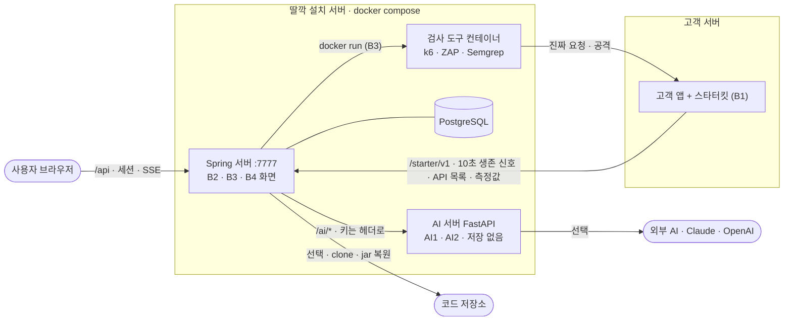

> 원본: Notion 시스템 아키텍처 (2026-10-27 기준). 이제 이 파일이 기준이다.

# 시스템 아키텍처

> **기준** · 딸깍 팀 가이드(10/26) "서버 구조 · 지킬 규칙 세 가지" · 2026-10-27 작성. 주고받는 JSON은 [openapi.yaml](openapi.yaml)(요약 [API 설계](api.md)), 테이블은 [DB 설계](db.md)

## 1. 구성 — 딸깍 서버는 두 개, 고객 쪽엔 스타터킷 하나

| 구성요소 | 누가 | 형태 | 하는 일 | 안 하는 일 |
| --- | --- | --- | --- | --- |
| **Spring 서버** | B2 · B3 · B4 화면 | Spring Boot 4.1 · Java 21 JAR 하나, React 빌드를 정적 리소스로 포함, `:7777` | 스타터킷 연결·API 목록 받는 쪽(B2, 11/3 B1에서 옮김), 계정·코드·검사 범위·결과·AI 서버 부르기(B2), 도구 실행·결과 원본(B3), 화면(B4) | — |
| **AI 서버** | AI1 · AI2 | Python FastAPI 컨테이너, 내부 포트만 | 키 확인·시나리오(AI1), 점수·쉬운 설명·수정 요청문(AI2) | 저장, 검사 도구 실행. Spring이 부를 때만 일한다 |
| **PostgreSQL** | 테이블 주인별 | 공식 이미지 컨테이너, 내부 포트만 | Spring 서버의 DB 하나 | 고객 앱 DB 아님 |
| **검사 도구** | B3 | k6 · ZAP · Semgrep 공식 이미지. 검사 때 Spring이 `docker run`, 끝나면 제거 | 사람 몰기(k6) · 공격 흉내(ZAP) · 코드 읽기(Semgrep) | 점수·설명 |
| **고객 서버** | 고객 · 스타터킷은 B1 | 고객 앱 + `io.ddalkkak:starter-kit` (의존성 한 줄) | 연결 확인, 10초마다 생존 신호, API 목록, 검사 중 앱 안쪽 측정 | 실제 데이터 값 전송 |
| **외부 AI** | — | Claude · OpenAI · OpenAI 호환 주소 | AI 서버가 부름 (선택) | — |
| **코드 저장소** | — | GitHub/GitLab · jar · ZIP · 내 컴퓨터 | B2가 가져옴 (선택) | — |



## 2. 지킬 규칙 세 가지

1. **화면은 Spring 서버하고만 이야기한다.** AI 서버를 직접 부르지 않는다. AI 서버 포트는 밖에 열지 않는다
2. **AI 서버는 아무것도 저장하지 않는다.** 필요한 건 Spring이 보내고, 결과도 Spring이 저장한다. AI 키도 Spring이 매 요청 헤더(`X-AI-Provider` `X-AI-Base-Url` `X-AI-Key` `X-AI-Model`)로 같이 보낸다
3. **Spring 안에서는 각자 자기 테이블만 직접 다룬다.** 남의 데이터는 그 사람이 만든 함수로 받는다([DB 설계 §4](db.md#4-남의-데이터는-이-함수로))

헷갈릴 때: 새로고침해도 남아야 하면 서버 일, 모양과 움직임이면 B4. 남의 코드를 고쳐야 하면 직접 고치지 말고 그 담당에게 요청한다.

## 3. 저장소 구조

저장소 하나. 서버·화면·AI·스타터킷·샘플 앱·약속 예시가 같은 커밋으로 움직인다.

```txt
ddalkkak/
├─ server/                  Spring Boot 4.1 (패키지는 아래 표)
├─ web/                     React 화면 · Pixel Space 토큰 · 빌드 결과를 server 정적 리소스로
├─ ai/                      FastAPI · plan/(AI1) · report/(AI2)
├─ starter-kit/             io.ddalkkak:starter-kit · Spring Boot 자동 설정 (B1)
├─ examples/order-api/      샘플 앱 · Spring Boot + PostgreSQL · 일부러 심은 문제 (B1)
├─ contracts/               약속 예시 파일 = 가짜 데이터
│  ├─ 1-starter/            hello · heartbeat · apis · measures
│  ├─ 2-scenarios/          check · scenarios
│  ├─ 3-reports/            reports 요청·응답 · prompts
│  └─ 4-screen/             화면별 응답
├─ docs/
└─ docker-compose.yml       server · ai · postgres
```

| 역할 | 만드는 곳 | 주 패키지 · 폴더 |
| --- | --- | --- |
| B1 | 스타터킷 + 샘플 앱 | `starter-kit/` · `examples/order-api/` |
| B2 | Spring 서버 | `server/…/starter`(스타터킷 받는 쪽, 11/3 B1에서 옮김) · `server/…/account` · `ai` (AI 서버 호출) · `code` · `run` · `scope`(검사 범위) · `result` · `update`(화면 업데이트, -221) |
| B3 | Spring 서버 + 검사 도구 | `server/…/scan` (실행 · 도구 · 결과 원본) |
| B4 | 화면 + 설치 | `web/` · `docker-compose.yml` · README 설치 안내 |
| AI1 | AI 서버 | `ai/plan/` · AI 서버 기본 틀은 AI2와 함께 |
| AI2 | AI 서버 | `ai/report/` |

## 4. 설치 · 실행

사용자는 저장소도 설정 파일도 받지 않고 출시 이미지 하나를 `docker run` 한다(README "설치", -202 · -207). Windows · Mac(Docker Desktop) · Linux 모두 같은 한 줄이고, bash · zsh · PowerShell에서 그대로 붙는다. 소스 빌드(개발 · 팀 서버 deploy.sh)는 지금처럼 `docker compose up -d --build`(Linux).

```bash
docker run --rm --pull always -v /var/run/docker.sock:/var/run/docker.sock -v "${HOME}:/host-home:ro" -e HOST_HOME="${HOME}" ghcr.io/mouse-ddalkkak/ddalkkak-server
```

- 출시: GitHub에 v* 태그가 오면 [`.github/workflows/release.yml`](../.github/workflows/release.yml)이 environment `release` 승인을 받은 뒤 `ghcr.io/mouse-ddalkkak/ddalkkak-server` · `ddalkkak-ai`를 amd64 · arm64로 `<버전>`(가장 높은 버전이면 `latest`도)에 올린다. server 이미지에는 빌드 인자로 그 버전(`DDALKKAK_VERSION`)이 들어간다
- server 시작점 [`server/start.sh`](../server/start.sh)는 두 가지로 돈다. `DB_URL`이 있으면(compose, 설치기가 띄운 `ddalkkak`) Spring만 띄운다. 없으면 **설치기**다. 사용자가 띄운 이 컨테이너는 `--rm`이라 설치가 끝나면 사라진다
- 설치기가 하는 일: ① `docker info`의 `OperatingSystem`으로 환경을 고른다(`Docker Desktop` · `OrbStack` → desktop, 그 밖 → host, `-e DDALKKAK_MODE`로 바꿀 수 있다. 두 환경의 차이는 [scan.md §2](scan.md#2-도구-컨테이너) 표) ② 볼륨 `ddalkkak-data` · `ddalkkak-pgdata`(desktop은 네트워크 `ddalkkak`도)를 만든다 ③ DB 비밀번호를 첫 설치 때 `ddalkkak-data`의 `db-password`에 만든다 ④ `ddalkkak-postgres`(`postgres:17-alpine`) · `ddalkkak-ai`(같은 버전)를 `--restart unless-stopped`로 띄우고 healthy를 1분 기다린다 ⑤ `ddalkkak`(이 이미지 그대로, `DB_URL` · `AI_BASE_URL` · `TARGET_HOST` · `TOOL_NETWORK` · `DATA_HOST_DIR` · `HOST_HOME` · `HOME_MOUNT`를 넣어)을 띄우고 `Started` 로그를 기다려 주소 · SSH 터널 예시 · 첫 비밀번호를 출력한다
- 포트(-227): `-e SERVER_PORT`를 주면 그 값(남이 쓰고 있으면 서버를 띄우지 않고 `포트 N 을 다른 프로그램이 쓰고 있다`로 멈춘다. 지금 딸깍이 그 포트면 그대로) → 지난 설치의 포트(라벨 `ddalkkak.config`의 `port=`, 업데이트 때 유지. 컨테이너가 멈춰 있으면 그 포트가 비어 있을 때만) → 7777부터 빈 포트. 설치기는 호스트 네트워크 밖이라 빈 포트를 보조 컨테이너로 본다(desktop은 `host.docker.internal:<포트>`에 붙어 보기 — Windows Docker Desktop은 남이 IPv4로 쓰는 포트도 `[::]`로 `-p`가 열려서 `-p` 시도로는 못 본다. 대신 `[::1]`에만 연 프로그램(Windows Node 17+ · Vite의 `localhost`)은 IPv4로 안 잡혀 `-p [::1]:<포트>:1`도 열어 보고 이미 쓰는 중 오류면 사용 중, 다른 컨테이너가 `[::1]`로 게시한 포트는 `docker ps`의 게시 포트로 본다, host는 `--network host`로 `/proc/net/tcp`의 LISTEN 포트, 100개까지). desktop은 `-p <포트>:7777`이라 컨테이너 안은 늘 7777, host는 매핑이 없어 Spring이 그 포트로 뜬다. 7777이 아니면 끝에 검사할 앱에 넣을 `DDALKKAK_URL=http://localhost:<포트>`를 안내한다
- `--sample` 인자(-227)를 주면 샘플 order-api도 띄운다. 이 이미지 안의 `/app/order-api.jar`(server Dockerfile이 같이 빌드)를 `--entrypoint java`로 `ddalkkak-sample`에, 그 앱 DB를 `ddalkkak-sample-postgres`(볼륨 없음)에 띄운다. 앱 포트는 8080부터 빈 포트(다시 돌리면 유지). desktop은 둘 다 `ddalkkak` 네트워크 · 앱 `-p 127.0.0.1:<포트>:<포트>` · `DDALKKAK_URL=http://ddalkkak:7777`, host는 DB `127.0.0.1:5433`(빈 포트) · 앱 host 네트워크 `127.0.0.1` · `DDALKKAK_URL=http://localhost:<딸깍 포트>`. 옵션이 없으면 띄우지 않고, 이미 떠 있는 샘플도 건드리지 않는다(지우기는 `uninstall`)
- 다시 돌리면(업그레이드) 같은 이미지 · 같은 설정(라벨 `ddalkkak.config`: 환경 · 네트워크 · 포트 · 넘기는 값)으로 돌고 있는 컨테이너는 그대로 두고 바뀐 것만 새로 띄운다. 버전도 `-e` 값도 같으면 아무것도 바꾸지 않는다.
- 화면 업데이트(-221, F-HOME-06): 서버가 `docker run -d --name ddalkkak-update --pull missing -v /var/run/docker.sock:/var/run/docker.sock ghcr.io/mouse-ddalkkak/ddalkkak-server:<새 버전> update`를 띄운다. 설치기 컨테이너는 `--rm` 없이 남아 도중에 실패하면 `docker logs ddalkkak-update`로 이유를 본다. 다음 업데이트가 띄우기 전에 `docker rm ddalkkak-update`(도는 것은 `-f`가 없어 남는다)로, `uninstall`이 다른 컨테이너와 같이 지운다(!165 리뷰 1-1). 인자 `update`는 설치 명령의 `-e` · 홈 `-v` 없이 오니, 지금 설치의 방식(라벨 첫 단어) · 홈 mount · `HOST_HOME` · `AI_ALLOWED_HOSTS` · host의 AI · DB 포트를 `ddalkkak` · `ddalkkak-ai` 컨테이너에서 읽어 위 업그레이드를 그대로 탄다. 설치기는 서버에 `DDALKKAK_INSTALL=docker-run`을 넘기고, 서버는 이때만 업데이트 버튼을 켠다(Compose는 compose가 컨테이너를 맡는다).
- `uninstall` 인자는 컨테이너(샘플 포함) · 네트워크 · 볼륨을 모두 지운다. 검사 중이었으면 서버를 먼저 지운 뒤 라벨 `io.ddalkkak.tool`이 붙은 도구 컨테이너도 지운다([scan.md §2](scan.md#2-도구-컨테이너), -197). 설치기 시험은 `server/start.test.sh`(가짜 docker)
- compose의 `depends_on: service_healthy`와 같은 이유로, ai · postgres가 healthy가 아니면 Spring을 띄우지 않는다(포트가 겹쳐 ai가 죽었는데 Spring이 그 포트의 남의 프로그램에 AI 키를 보내지 않게)
- 홈은 `/host-home`에 읽기 전용으로 붙인다. 설치기는 자기 컨테이너의 `/host-home` 마운트 원본을 `docker inspect`로 읽어 `ddalkkak`에 그대로 붙인다(Windows면 Docker Desktop이 바꾼 VM 쪽 경로). "내 컴퓨터" · jar 경로를 바꾸는 규칙은 [run-flow.md §5](run-flow.md#5-코드-가져오기)
- 첫 기동에 admin 계정과 임의 비밀번호를 만들어 터미널과 0-1 화면에 한 번만 보여준다. 분실 시 `docker exec ddalkkak ddalkkak reset-password`(README Compose 예시는 `docker compose exec ddalkkak ddalkkak reset-password`, 소스 빌드 compose는 `docker compose exec server …`)
- **대상 환경은 Docker가 도는 곳 어디든이다**(11/5 B2 결정 -207, 10/31 "Linux 서버만"을 바꿈). 검사 도구 · Spring이 고객 앱을 부르는 주소(`localhost` · `host.docker.internal`)와 도구 네트워크(`host` · `bridge`)는 설치기가 정해 넘기고, 서버 코드는 그 값만 쓴다([scan.md §2](scan.md#2-도구-컨테이너))
- Spring 이미지에는 docker CLI 정적 바이너리(`COPY --from=docker:<고정 버전>-cli`)가 들어 있어 소켓으로 검사 도구를 형제 컨테이너(`docker run --rm --network {TOOL_NETWORK} --user 0:0`)로 띄운다. 검사 도구는 첫 검사 때 이미지를 받는다. 코드 가져오기용 git과 Vineflower(jar → 코드 복원)도 들어 있다
- 고객 앱은 딸깍과 같은 컴퓨터에서 돌고, 스타터킷이 `localhost:7777`의 딸깍을 스스로 찾는다(desktop은 7777을 `-p`로 열어 그 PC의 `localhost:7777`이 딸깍이다). 설치기가 7777이 아닌 포트를 골랐으면 앱에 `DDALKKAK_URL`을 넣는다(-227)

## 5. 통신 한눈에

| 누가 → 누구 | 방식 | 주기 · 시점 | 약속 |
| --- | --- | --- | --- |
| 스타터킷 → Spring | HTTP JSON `/starter/v1` | 켜질 때 hello, 10초마다 생존 신호, 요청받으면 API 목록, 검사 중 1초마다 측정값 | ① |
| Spring → 스타터킷 | 생존 신호 응답의 `commands` | 딸깍은 먼저 연락하지 않는다 (10초 안에 전달) | ① |
| Spring → AI 서버 | HTTP JSON `/ai/*` + 키 헤더 | 연결 확인 · 검사 계획 · 결과 정리 · 수정 요청문 | ② ③ |
| 화면 → Spring | HTTP JSON `/api/*` · 진행은 SSE | 화면 열 때, 홈은 10초 | ④ |
| Spring → 검사 도구 | 도커 소켓으로 `docker run --rm --network {TOOL_NETWORK} --user 0:0` · 결과 파일·로그를 `${DATA_HOST_DIR}`(`/root/.ddalkkak`의 호스트 쪽 경로)로 회수 | 검사 실행 단계 | — ([검사 설계 §2](scan.md#2-도구-컨테이너)) |
| 검사 도구 → 고객 앱 | `http://{TARGET_HOST}:{port}`(Linux `localhost` · Docker Desktop `host.docker.internal`)로 진짜 HTTP 요청·공격 | 검사 중 | — |
| Spring → 고객 앱 | `http://{TARGET_HOST}:{port}`로 테스트 계정 가입 · 로그인, 권한 점검 요청 · 연결 점검 `GET /`(5초 대기, 응답이 오면 성공 · 내용은 보지 않음, -223) | 검사 중 (auth · sec 단계) · 연결 점검은 해제하지 않은 동안(생존 신호가 끊겨도) 30초마다 | — ([검사 설계 §6 · §7](scan.md#6-권한-점검-딸깍이-직접) · F-CONN-06) |

## 6. 기술

| 부분 | 기술 |
| --- | --- |
| Spring 서버 | Spring Boot 4.1 · Java 21 · Spring Data JPA · PostgreSQL 드라이버 · SSE |
| 화면 | React · Pixel Space 디자인 토큰(Galmuri11 · ink-900) · 화면 13개([화면 설계서](screens.md)) |
| AI 서버 | Python · FastAPI · 제공자별 LLM 클라이언트 |
| 스타터킷 | Java 라이브러리 · Spring Boot 자동 설정 (3주 범위는 Spring Boot만) |
| DB | PostgreSQL 컨테이너 |
| 검사 도구 | k6 · ZAP · Semgrep 공식 Docker 이미지 |
