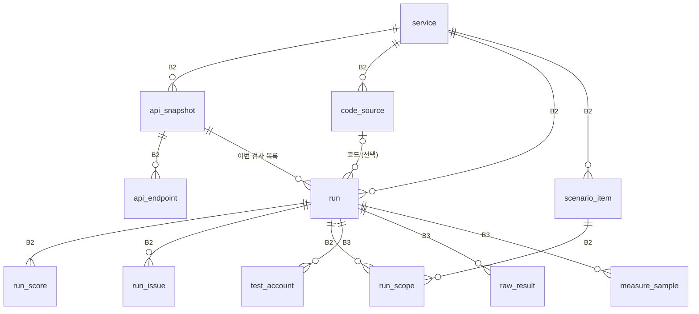

> 원본: Notion DB 설계 (2026-10-27 기준). 이제 이 파일이 기준이다.

# DB 설계

> **기준** · 딸깍 팀 가이드(10/26) "지킬 규칙 세 가지" + [API 설계](api.md) 약속 ①~④ · 2026-10-27 작성
> **확정 상태** · B2 테이블 11개 모두 마이그레이션으로 확정(10/31 B3에서 옮겨 온 `scenario_item` · `run_scope`는 -130 `V202610312040` · `V202610312041`, 11/3 B1에서 옮겨 온 `service` · `api_snapshot` · `api_endpoint`는 -181 `V202611031200`). B3 테이블은 주인이 마이그레이션을 만들 때 확정한다. 이전 판(H2 · runs JSON)은 Notion 페이지 기록에 있음

## 1. 저장 원칙

- **DB는 Spring 서버에 하나** · PostgreSQL 컨테이너(`docker compose`의 `postgres`). AI 서버는 아무것도 저장하지 않는다
- **각자 자기 테이블만 직접 다룬다** · 남의 데이터는 그 사람이 만든 함수로 받는다(§4). 테이블 주인 = 아래 표의 역할
- **저장하지 않는 것** · 허용 전 연결 요청, 10초 생존 신호(최신 값만 메모리. CPU만 성능 측정 근거로 최근 1시간 메모리, -248), 고객 앱의 실제 데이터 값, 코드 자체(작업 폴더에만), 수정 요청문
- **비밀값** · AI 키·저장소 토큰·테스트 계정 비밀번호·검사 대상 앱 로그인 값(`target_auth`)은 `_enc` 컬럼(AES-GCM), 관리자 비밀번호는 해시. 마스터 키는 설치 때 만든 파일(`~/.ddalkkak/master.key`, DB와 따로). 이 파일을 잃으면 서버가 다음 기동 때 새 키를 만들고, 저장된 값은 못 푼다: AI 설정은 "AI 없음"으로 보이고 다시 연결하면 새 키로 덮인다. 저장소 토큰은 토큰 없이 가져와 본다(공개 저장소는 받히고 비공개는 "토큰을 확인해 주세요"). 검사 대상 앱 로그인 값은 기동 때 풀어 보고 못 풀면 값만 지우고 `key_lost`로 둬서 화면 4가 다시 등록을 요청한다 — 검사 결과는 지우지 않는다(-230)
- **파일** · 도구 원본 로그 `~/.ddalkkak/runs/{runId}/raw/{tool}.log`(B3), 코드 작업 폴더 `~/.ddalkkak/work/{serviceId}/{codeSourceId}/`(B2, [run-flow.md §5](run-flow.md#5-코드-가져오기))

## 2. 테이블 — 주인별

| 주인 | 테이블 | 컬럼 | 쓰는 기능 |
| --- | --- | --- | --- |
| B2 | `service` | id · name · framework · framework_version · java_version · build_tool · host · port · pid · starter_version · running_commit · approved_at · token_hash · disconnected_at · artifact · work_dir. artifact · work_dir는 hello의 실행 파일 · 작업 폴더 경로(디컴파일 후보 F-CODE-05, 옛 스타터킷이면 null, -224). disconnected_at = 연결 해제 시각, null이면 연결 중 — 해제해도 줄은 남긴다(검사 이력, -223). 같은 앱을 다시 허용하면 그 줄을 다시 쓰며 null로 되돌린다. 해제하지 않은 줄(null)은 늘 많아야 하나다(F-CONN-04). 연결 상태 · 마지막 생존 신호는 저장하지 않고 메모리에만(F-CONN-06, -181). token_hash는 스타터킷 토큰의 SHA-256 hex — 원문은 저장하지 않는다(-211 `V202611061500`) | F-CONN-04 · F-CODE-03 · F-HOME-02 |
| B2 | `api_snapshot` | id · service_id → service · taken_at · api_count · added · removed · changed. SEND_APIS를 실을 때 빈 줄(api_count 0)로 만들고 목록이 오면 채운다 — api_count 0 = 아직 못 받음 | F-API-03·04 |
| B2 | `api_endpoint` | id · snapshot_id → api_snapshot · method · path · params(JSON: name·in·type·required) · auth_required · role · handler · calls · change(new·changed·same) | F-API-03·04 · F-PLAN-01 · F-RES-05 |
| B2 | `admin_account` | id · username · password_hash · setup_acked · first_login_done · created_at | F-INST-02·03 · F-AUTH-01·02 |
| B2 | `ai_setting` | id(=1) · provider(claude·openai·custom) · base_url · api_key_enc · model · last_check_at · last_check_ok | F-AI-01~03 |
| B2 | `code_source` | id · service_id → service · type(github·jar·zip·local·none) · ref · branch · token_enc · last_commit · last_commit_at · last_fetched_at · decompiled · file_hash. 가져올 때마다 새 줄 — 0-3 ④에서 저장할 때도, 검사 준비가 저장한 방식으로 다시 가져올 때도(-224). 가장 최근 성공한 줄이 저장한 방식. none도 줄을 남긴다. -242 전에 올린 ZIP 줄은 보관 파일이 없어 last_fetched_at을 비웠다(`V202611121500`). file_hash = ZIP · jar · war 파일 sha256 앞 12자 | F-CODE-01~05 |
| B2 | `run` | id · service_id → service · snapshot_id → api_snapshot · code_source_id → code_source(없으면 null) · status(preparing·ready·running·stopped·partial·done·failed) · ai_mode(llm·default) · ai_asked(준비 때 AI(키)를 쓰기로 했는지 — ai_mode는 `/ai/scenarios` 응답 source라 키를 실어 재검사(`changed`)를 부르거나 AI 호출이 실패해도 default다. 지난 항목을 그대로 쓸지는 이 값을 지난 회차와 비교한다, -252) · started_at · finished_at · result_seen_at(끝난 회차의 결과를 처음 연 시각, 비면 홈 '검사 완료' -214) · interrupted_at(딸깍이 다시 켜져 멈춘 시각, 차 있으면 홈 '이어서 검사할까요?' · 이어서 · 여기까지를 고르면 비움 -228) · stop_chosen_at(사용자가 중단 · 여기까지를 고른 시각, 차 있으면 결과 정리 중에 다시 켜져도 interrupted_at을 찍지 않음 · 이어서 검사를 시작하면 비움, !143 리뷰 3-3) · resumed_at(이어서 검사를 시작한 시각, 소요 시간 · 팀 서버 배포 대기는 차 있으면 이것부터 셈, -228) · scenario_count · item_count · skip_reason(미검사 사유 중 가장 많은 것) · project_name(프로젝트 이름 1~100자, 만들 때 연결된 서비스 이름 · 8 · 6 ✎로 그 회차만 고침, -237) | F-API-01 · F-RPT-07 · F-HIST-01 · F-HIST-05 · F-HOME-03 |
| B2 | `run_score` | run_id → run · area(perf·sec·code) · score(0–100, 미검사 null) · pass_count · fail_count · summary_line · skip_reason · passed(JSON [{name, value}]) · halted(영역에 멈춘 시나리오가 있음, 이력 태그) · PK(run_id, area) | F-RPT-07 · F-RES-01 · F-HIST-02 |
| B2 | `run_issue` | id · run_id → run · issue_key(p2) · item_key · area · level(danger·warn) · certainty(confirmed·suspected) · title · tech · impact · as_is(JSON) · to_be(JSON) · metrics(JSON) · suspect_reason · where_text · cause · fix(JSON) · pass_criteria · penalty(감점 30 · 10, -247) · rule_id(③ 내부용 규칙 ID, 코드 위치 좁히기, -247) · location_file · location_line · code_lines(JSON, 저장 때 읽은 코드 몇 줄) | F-RPT-07 · F-RES-01~05 |
| B2 | `scenario_item` | id · service_id → service · item_key(perf-1) · area · tool(k6·zap·semgrep·ddalkkak) · title · api · target · why · params(JSON) · recommended · excluded · exclude_reason · source(llm·default·manual) · api_signature(지금 안 씀) | F-PLAN-05 · F-SCOPE-01·05 |
| B2 | `run_scope` | run_id → run · item_id → scenario_item · included · params(JSON, 바꾼 칸만) · reused · PK(run_id, item_id) | F-SCOPE-02~07 |
| B3 | `test_account` | id · run_id → run · username(ddalkkak-test-xxxx) · password_enc | F-RUN-03 · F-RES-03 |
| B3 | `target_auth` | id · service_id(UNIQUE, FK 없음 — run.service_id처럼) · mode(account·token·cookie) · login_api · signup_api · token_at(body.token·header.Authorization·cookie.SESSION, 쿠키 이름이 많으면 앞 몇 개 + "외 N개"로 100자 안) · hint(가린 값, 쿠키 이름이 많으면 앞 몇 개 + "외 N개"로 200자 안) · secret_enc(계정은 {username, password} JSON · 만료 · 키 분실이면 null) · state(ok·expired·key_lost) · last_used_at(30일 지나면 지움) · witness_api(토큰 · 쿠키가 통한 로그인 필요 GET, 다음 회차 맨 앞 확인 · 새 값 저장 때 비움, !141 리뷰 6-2) | F-SCOPE-09 · F-RUN-03 (-230) |
| B3 | `raw_result` | id · run_id → run · item_key · area · tool · api · status(done·partial·skipped) · skip_reason · metrics(JSON) · findings(JSON) · evidence(JSON) · passed(JSON, 통과한 검사 · -200) · log_path · started_at · ended_at | F-RPT-01 · F-RES-06 |
| B3 | `measure_sample` | id · run_id → run · ts · api · requests · db_queries_per_request · db_wait_ms · pool_active · pool_max · pool_waiting | F-RUN-08·09 |

B4 · AI1 · AI2는 테이블이 없다. `raw_result.metrics/findings/evidence/passed` 모양은 약속 ③ `results[]`, `run_issue`는 약속 ③ 응답 `issues[]`와 같다.

## 3. 관계



`admin_account` · `ai_setting`은 단독 테이블이다.

## 4. 남의 데이터는 이 함수로

다른 역할 테이블이 필요하면 Repository를 직접 주입하지 않고 주인이 만든 함수를 부른다. B3 `RawResults` · `Repro`는 -134에서 확정했다(11/3). B3 행은 B1 행과 같은 방식으로 B2가 시그니처와 **빈 구현**을 `server/…/scan`에 먼저 두어 지금 붙여 컴파일할 수 있다(`RawResults`는 -136, `Repro`는 -137에서). 실제 구현은 B3 -134 몫이다. 검사 범위(`scenario_item` · `run_scope` · `ScenarioStore`)는 10/31 B3에서 B2로 옮겼다(-130 · -138). `ServiceRegistry` · `ApiCatalog` · `Measurements`는 10/30 B1이 확정했고 11/3 재편으로 B2가 실제 구현했다(-181, `server/…/starter`). id는 API와 같은 문자열(`svc_1` · `snap_12` · `run_5`).

| 주인 | 함수 | 부르는 사람 | 쓰는 기능 |
| --- | --- | --- | --- |
| B2 | `ServiceRegistry.current()` → `Optional<ConnectedService(id, name, host, port, runningCommit, connected, framework, artifact, workDir)>` · 연결된 서비스(해제하지 않은 줄) 없으면 empty — 해제한 줄은 보지 않는다(-223). 그래서 지난 회차에 딸린 값(결과 6 `service` · 다시 해석 때 결과 원본 `service` · 요청문 `framework`)은 `current()`가 아니라 그 회차 `run.service_id`의 줄을 `ServiceRegistry.byId("svc_N")` → `Optional<ConnectedService>`(해제한 줄도 · 없으면 empty, -237)로 읽는다 — 해제했거나 다른 서비스가 연결돼 있어도 그 회차의 서비스(-223) · connected = 30초 안에 생존 신호 · framework = `Spring Boot 3.2`(hello의 framework + 버전 앞 두 자리, -181에서 더함) · artifact · workDir = hello의 그 칸(service.artifact · work_dir, 옛 스타터킷이면 null) — 디컴파일 후보가 읽는다(-224, 구현은 B1 MR 2 · B2 리뷰) [확정] | B2 · B3 · B1 | F-CODE-03 · F-API-01 · F-CODE-05 |
| B2 | `ApiCatalog.requestLatest(serviceId)` → `CompletableFuture<String>` snapshotId · 20초 안에 목록이 안 오면 같은 snapshotId로 1번 더, 그래도 없으면 `ApiException(SERVICE_OFFLINE)` · 0개면 `ApiException(NO_APIS)` · 연결이 끊겼으면 바로 SERVICE_OFFLINE [확정] | B2 | F-API-01 |
| B2 | `ApiCatalog.endpoints(snapshotId)` → `List<Endpoint(method, path, params, authRequired, role, handler, calls, change)>` [확정] · `ApiCatalog.changed(snapshotId, baseSnapshotId)` → `ApiDiff(added, removed, changed, apis[{api, change}])` (준비 상태 `apiDiff`와 같은 모양). baseSnapshotId 목록과 비교하고, null이면 전부 new. B2는 마지막으로 끝난 회차의 `run.snapshot_id`를 넘긴다([run-flow.md §2](run-flow.md#2-준비-화면-3)). 10/31 -164 리뷰에서 인자를 더함 — B1 확인 | B2 · B3 | F-PLAN-01 · F-RUN-04~06 |
| B2 | `Measurements.start(runId, Consumer<List<Sample>> onSamples)` · `stop(runId)` · `Sample`은 약속 ① MeasureSample과 같은 값 [확정] | B3 | F-RUN-02 · F-RUN-09 |
| B2 | `ServiceRegistry.cpuBetween(serviceId, from, to)` → `List<Double>` 그 서비스가 from ~ to(양끝 포함)에 보낸 생존 신호 `health.cpu`(앱 PC 시스템 CPU 0~1) · 받은 순서 · 없으면 빈 목록. CPU를 못 읽은 앱이 보내는 0 이하는 담지 않는다. 최근 1시간만 메모리에 둔다(재시작하면 비어도 되는 근거) [확정] -248 | B3 | F-RPT-04 · F-RPT-06 |
| B2 | `CodeWorkspace.dir(runId)` → `Optional<Path>` 그 회차 코드의 작업 폴더(`~/.ddalkkak/work/{serviceId}/{codeSourceId}/`) · 코드 없이 검사하면, 폴더가 정리돼 없으면 empty [확정] · -144에서 진짜가 됐다 | B3 | F-RUN-07 |
| B2 | `AiClient.call(path, body, type, timeout)` → 저장된 키를 `X-AI-*` 헤더로 붙여 AI 서버 호출 (설정 없으면 헤더 없이) · 응답 없음은 `IOException` [확정] | B2 안 | F-AI-02 · F-PLAN-01 · F-RPT-03 · F-PROMPT-02 |
| B2 | `RunLifecycle.start(runId)` → ready → running · 같은 서비스에 running 회차가 있으면(이 회차가 이미 running인 것도) `ApiException(RUN_IN_PROGRESS)`, 없거나 ready · running이 아니면 `ApiException(NOT_FOUND)` [확정] | B3 | F-SCOPE-08 |
| B2 | `RunLifecycle.onScanFinished(runId, RunStatus end)` → end = DONE · PARTIAL(여기까지) · STOPPED(중단). `/ai/reports` → run_score · run_issue 저장 → 상태 end. 저장이 끝날 때까지 막힌다(최대 약 2분 20초) → B3 검사 스레드에서 부르고 돌아오면 SSE `done`. AI 서버가 두 번 다 답하지 않으면 저장 없이 상태만 바꾼다. running이 아닌 회차는 `ApiException(NOT_FOUND)` [확정] | B3 | F-RPT-02 · F-RUN-11 · F-STOP-03 |
| B2 | `RunHistory.latest(serviceId)` → `Optional<LastRun(runId, at, scores, topDanger, topWarn, passed, skipped)>` (openapi `Home.lastRun`과 같은 모양) · 검사가 없으면 empty [확정] · `RunHistory.state(serviceId)` → `RunState(state, runId, interruptedAt)` = openapi `Home.run`: running 회차가 있으면 running · 마지막 끝난 회차가 딸깍 재시작으로 멈췄으면(`interrupted_at`) interrupted + 멈춘 단계(B3 `RawResults.stopPoint`) · 그 회차의 결과(`GET /api/runs/{id}`)를 아직 안 열었으면 done · 그 밖 none [확정] -214 · -228 | B2 안 (`GET /api/home`) | F-HOME-03 · F-STOP-05 |
| B2 | `RunLifecycle.stopChosen(runId)` → 사용자가 중단 · 여기까지를 골랐다(running 회차의 `stop_chosen_at`만 찍음, 아니면 아무것도 안 함). B3 `ScanRunner`가 중단 · 멈춤 팝업 여기까지 · 재시작 회차 여기까지에서 부른다 — 결과 정리 중에 다시 켜져도 이어서 묻지 않게 (!143 리뷰 3-3, -228) | B3 | F-STOP-05 |
| B2 | `RunLifecycle.interrupted(runId)` → 딸깍 재시작으로 멈춰 이어서 할지 기다리는 회차인지(stopped · `interrupted_at` · 그 서비스의 마지막 끝난 회차) · `RunLifecycle.resume(runId)` → stopped → running, finished_at · result_seen_at · interrupted_at을 비움. 기다리는 회차가 아니면 `ApiException(NOT_FOUND)`, 같은 서비스에 running이 있으면 `ApiException(RUN_IN_PROGRESS)` [확정] -228 | B3 (`POST /api/runs/resume` · `/finish-partial`) | F-STOP-05 |
| B2 | `ScenarioStore.save(String runId, List<ScenarioStore.Item> items)` · `ScenarioStore.forApis(String serviceId)` → `List<ScenarioStore.Item>` ([run-flow.md §7](run-flow.md#7-검사-범위-화면-4)) [확정] | B2 안 | F-PLAN-05 · F-SCOPE-07 |
| B2 | `ScenarioStore.scope(String runId)` → `List<ScenarioStore.Item>` · 이번 회차에 포함된 시나리오와 조정된 `params`(시나리오 값 위에 바꾼 값을 덮은 것). `Item`은 약속 ② 시나리오와 같은 칸(key · area · tool · title · api · target · why · params · recommended · excluded · excludeReason · reused · source) ([scan.md §1](scan.md)) [확정] | B3 | F-RUN-01 |
| B2 | `RunLookup.find(String runId)` → `Optional<RunLookup.Info(id, serviceId, status, aiMode, aiAsked, hasCode, snapshotId, codeSourceId)>` · `"run_5"` 모양이 아니거나 없으면 empty [확정] | B3 | F-RUN-10 |
| B2 | `RunLookup.running(Long serviceId)` · `running(String serviceId)`(`"svc_1"`) → `boolean` · 그 서비스에 검사 중(running) 회차가 있는지. 연결 해제(409 `RUN_IN_PROGRESS`) · 연결 점검(검사 중엔 실패를 세지 않음) · 화면 업데이트(검사 중엔 409, -221)가 본다 (-223) [확정] | B1 · B2 | F-CONN-06 · F-CONN-09 · F-HOME-06 |
| B3 | `RawResults.of(runId)` → `RawReport` = 약속 ③ 요청 본문(openapi `RawReport`). `results`는 raw_result 줄을 검사 범위 순서로, `params`는 `ScenarioStore.scope`의 값, `conditions.testAccount`는 test_account 첫 이름(없으면 null), `service.name`은 그 회차 서비스(`ServiceRegistry.byId`, -237), `service.framework`는 B1 `ConnectedService`에 아직 없어 "Spring Boot"(-118). 없는 회차는 `ApiException(NOT_FOUND)` [확정] · -134에서 진짜가 됐다 | B2 | F-RPT-03 |
| B3 | `RawResults.stopPoint(runId)` → `StopPoint(step, name)` · 딸깍 재시작으로 멈춘 회차의 멈춘 단계 — 실행 순서(테스트 계정 → 1 보안 → 2 성능 → 3 코드 품질)로 끝나지 않은 시나리오가 있는 첫 단계, 다 끝났으면 결과 정리(`report`). step · name은 `GET /api/runs/{id}/progress` steps와 같은 값. 읽다 실패해도 결과 정리로 답한다 [확정] -228 | B2 (`RunHistory.state`) | F-STOP-05 |
| B3 | `Repro.of(runId, itemKey)` → `Repro.Trace(testAccount, logs)` · 그 시나리오가 쓴 테스트 계정 이름(없으면 null)과 관측 근거 로그 몇 줄. 로그는 7 문제 상세의 관측 근거와 수정 요청문 끝의 관측 로그(`includeLogs: true`, 고른 문제마다 이어 붙음)에 같이 쓰니 시나리오당 몇 줄로 짧게. 재현 조건의 사람 수·시간·모양·주소는 검사 범위가 B2로 옮겨 와서 B2 `ScenarioStore.scope(runId)`에서 읽는다. `itemKey`가 null이면(`run_issue.item_key`는 null 허용) `Trace(null, [])`. 로그는 그 시나리오의 근거 줄(`raw_result.evidence`, 집계 · 개수만이라 고객 값 · 비밀값이 없음 — -142 규칙), 계정은 토큰을 싣고 돈 성능 · 보안 시나리오만(코드 품질 · 건너뜀은 null). 모르는 키 · 없는 회차도 `Trace(null, [])` [확정] · -134에서 진짜가 됐다 | B2 | F-RES-03 · F-PROMPT-02 |

## 5. ERDCloud용 DDL

ERDCloud에서 새 ERD → **Import → SQL**에 붙이면 §2 테이블 14개가 그려진다(MySQL 문법, `JSON` 컬럼). 실제 DB는 PostgreSQL이라 `AUTO_INCREMENT` → `GENERATED ALWAYS AS IDENTITY`, `JSON` → `TEXT`(JSON 문자열, §6)로 바뀐다. 실제 테이블은 §6의 Flyway SQL이 만든다.

```sql
-- B2 (11/3 B1에서 옮김)
CREATE TABLE service (
  id BIGINT NOT NULL AUTO_INCREMENT,
  name VARCHAR(100) NOT NULL,
  framework VARCHAR(50), framework_version VARCHAR(30), java_version VARCHAR(10), build_tool VARCHAR(20),
  host VARCHAR(255) NOT NULL, port INT NOT NULL, pid INT,
  starter_version VARCHAR(20), running_commit VARCHAR(40),
  approved_at TIMESTAMP NOT NULL, token_hash VARCHAR(64),
  disconnected_at TIMESTAMP COMMENT '연결 해제 시각 · null = 연결 중. 해제해도 줄은 남김(검사 이력), -223',
  artifact VARCHAR(1024) COMMENT 'hello 실행 중인 jar · war 경로, -224', work_dir VARCHAR(1024) COMMENT 'hello 작업 폴더, -224',
  PRIMARY KEY (id)
);
CREATE TABLE api_snapshot (
  id BIGINT NOT NULL AUTO_INCREMENT,
  service_id BIGINT NOT NULL, taken_at TIMESTAMP NOT NULL,
  api_count INT NOT NULL, added INT NOT NULL DEFAULT 0, removed INT NOT NULL DEFAULT 0, changed INT NOT NULL DEFAULT 0,
  PRIMARY KEY (id), FOREIGN KEY (service_id) REFERENCES service (id)
);
CREATE TABLE api_endpoint (
  id BIGINT NOT NULL AUTO_INCREMENT,
  snapshot_id BIGINT NOT NULL,
  method VARCHAR(10) NOT NULL, path VARCHAR(512) NOT NULL,
  params JSON COMMENT '[{name,in,type,required}]',
  auth_required BOOLEAN NOT NULL DEFAULT FALSE, role VARCHAR(50),
  handler VARCHAR(255) COMMENT 'OrderController#get', calls BIGINT NOT NULL DEFAULT 0,
  `change` VARCHAR(10) NOT NULL DEFAULT 'same' COMMENT 'new | changed | same',
  PRIMARY KEY (id), FOREIGN KEY (snapshot_id) REFERENCES api_snapshot (id)
);

-- B2
CREATE TABLE admin_account (
  id BIGINT NOT NULL AUTO_INCREMENT,
  username VARCHAR(50) NOT NULL UNIQUE, password_hash VARCHAR(100) NOT NULL,
  setup_acked BOOLEAN NOT NULL DEFAULT FALSE, first_login_done BOOLEAN NOT NULL DEFAULT FALSE,
  created_at TIMESTAMP NOT NULL DEFAULT CURRENT_TIMESTAMP,
  PRIMARY KEY (id)
);
CREATE TABLE ai_setting (
  id BIGINT NOT NULL COMMENT '항상 1',
  provider VARCHAR(20) COMMENT 'claude | openai | custom', base_url VARCHAR(512),
  api_key_enc VARCHAR(1024) COMMENT 'AES-GCM', model VARCHAR(100),
  last_check_at TIMESTAMP, last_check_ok BOOLEAN,
  PRIMARY KEY (id)
);
CREATE TABLE code_source (
  id BIGINT NOT NULL AUTO_INCREMENT,
  service_id BIGINT NOT NULL,
  type VARCHAR(10) NOT NULL COMMENT 'github | jar | zip | local | none',
  ref VARCHAR(512), branch VARCHAR(100), token_enc VARCHAR(1024),
  last_commit VARCHAR(40), last_commit_at TIMESTAMP, last_fetched_at TIMESTAMP, decompiled BOOLEAN NOT NULL DEFAULT FALSE,
  file_hash VARCHAR(12) COMMENT 'ZIP · jar · war sha256 앞 12자, -224',
  PRIMARY KEY (id), FOREIGN KEY (service_id) REFERENCES service (id)
);
CREATE TABLE run (
  id BIGINT NOT NULL AUTO_INCREMENT,
  service_id BIGINT NOT NULL, snapshot_id BIGINT, code_source_id BIGINT,
  status VARCHAR(10) NOT NULL COMMENT 'preparing | ready | running | stopped | partial | done | failed',
  ai_mode VARCHAR(10) NOT NULL DEFAULT 'default' COMMENT 'llm | default',
  ai_asked BOOLEAN NOT NULL DEFAULT FALSE COMMENT '준비 때 AI(키)를 쓰기로 했는지 · 재검사 · 호출 실패여도 true, 기본 범위로 바로 가기면 false(기다리던 changed 요청을 다시 보내 지난 AI 카드가 이어지면 true), -252',
  started_at TIMESTAMP, finished_at TIMESTAMP, result_seen_at TIMESTAMP,
  interrupted_at TIMESTAMP COMMENT '딸깍 재시작으로 멈춘 시각 · 홈 이어서 검사 확인, -228',
  stop_chosen_at TIMESTAMP COMMENT '사용자가 중단 · 여기까지를 고른 시각 · 재시작 때 이어서 묻지 않음, -228',
  resumed_at TIMESTAMP COMMENT '이어서 검사를 시작한 시각 · 소요 시간 · 배포 대기는 이것부터, -228',
  scenario_count INT NOT NULL DEFAULT 0, item_count INT NOT NULL DEFAULT 0, skip_reason VARCHAR(100),
  project_name VARCHAR(100) NOT NULL COMMENT '프로젝트 이름 · 기본값은 시작 때 서비스 이름, -237',
  PRIMARY KEY (id),
  FOREIGN KEY (service_id) REFERENCES service (id),
  FOREIGN KEY (snapshot_id) REFERENCES api_snapshot (id),
  FOREIGN KEY (code_source_id) REFERENCES code_source (id)
);
CREATE TABLE run_score (
  run_id BIGINT NOT NULL, area VARCHAR(10) NOT NULL COMMENT 'perf | sec | code',
  score INT COMMENT '0~100, 미검사 null', pass_count INT NOT NULL DEFAULT 0, fail_count INT NOT NULL DEFAULT 0,
  summary_line TEXT, skip_reason VARCHAR(100), passed JSON COMMENT '[{name,value}]',
  halted BOOLEAN NOT NULL DEFAULT FALSE COMMENT '멈춘 시나리오가 있음 · 이력 태그 "일부 완료 · 성능 중단됨"',
  PRIMARY KEY (run_id, area), FOREIGN KEY (run_id) REFERENCES run (id)
);
CREATE TABLE run_issue (
  id BIGINT NOT NULL AUTO_INCREMENT,
  run_id BIGINT NOT NULL, issue_key VARCHAR(20) NOT NULL, item_key VARCHAR(50),
  area VARCHAR(10) NOT NULL, level VARCHAR(10) NOT NULL COMMENT 'danger | warn',
  certainty VARCHAR(10) COMMENT 'confirmed | suspected',
  title TEXT NOT NULL, tech TEXT, impact TEXT COMMENT 'LLM이 쓰는 글은 TEXT',
  as_is JSON, to_be JSON, metrics JSON, suspect_reason TEXT,
  where_text TEXT, cause TEXT, fix JSON, pass_criteria TEXT, penalty INT, rule_id VARCHAR(255),
  location_file VARCHAR(512), location_line INT, code_lines JSON COMMENT '저장 때 읽은 코드 몇 줄',
  PRIMARY KEY (id), FOREIGN KEY (run_id) REFERENCES run (id)
);

-- B2 (검사 범위, 10/31 B3에서 옮김)
-- scenario_item 줄은 넣은 뒤 바꾸지 않는다. reused가 아니면 늘 새 줄이라 같은 (service_id, item_key)가 여럿일 수 있다 (run-flow.md §7)
CREATE TABLE scenario_item (
  id BIGINT NOT NULL AUTO_INCREMENT,
  service_id BIGINT NOT NULL, item_key VARCHAR(50) NOT NULL,
  area VARCHAR(10) NOT NULL, tool VARCHAR(20) NOT NULL COMMENT 'k6 | zap | semgrep | ddalkkak',
  title TEXT NOT NULL, api VARCHAR(512), target TEXT, why TEXT,
  params JSON, recommended BOOLEAN NOT NULL DEFAULT FALSE,
  excluded BOOLEAN NOT NULL DEFAULT FALSE, exclude_reason TEXT,
  source VARCHAR(10) NOT NULL DEFAULT 'default' COMMENT 'llm | default | manual',
  api_signature VARCHAR(64) COMMENT '이 항목을 만든 API 모양의 해시',
  PRIMARY KEY (id), FOREIGN KEY (service_id) REFERENCES service (id)
);
CREATE TABLE run_scope (
  run_id BIGINT NOT NULL, item_id BIGINT NOT NULL,
  included BOOLEAN NOT NULL DEFAULT TRUE, params JSON COMMENT '사용자가 바꾼 칸만',
  reused BOOLEAN NOT NULL DEFAULT FALSE COMMENT '재검사에서 지난 시나리오를 그대로 씀',
  PRIMARY KEY (run_id, item_id),
  FOREIGN KEY (run_id) REFERENCES run (id), FOREIGN KEY (item_id) REFERENCES scenario_item (id)
);
-- B3
CREATE TABLE test_account (
  id BIGINT NOT NULL AUTO_INCREMENT,
  run_id BIGINT NOT NULL, username VARCHAR(50) NOT NULL, password_enc VARCHAR(1024) NOT NULL,
  PRIMARY KEY (id), FOREIGN KEY (run_id) REFERENCES run (id)
);
CREATE TABLE target_auth (
  id BIGINT NOT NULL AUTO_INCREMENT,
  service_id BIGINT NOT NULL UNIQUE,
  mode VARCHAR(10) NOT NULL COMMENT 'account | token | cookie',
  login_api VARCHAR(300), signup_api VARCHAR(300),
  token_at VARCHAR(100) COMMENT '계정 로그인 응답에서 값을 찾은 자리',
  hint VARCHAR(200) COMMENT '화면에 보일 가린 값',
  secret_enc VARCHAR(8192) COMMENT '만료 · 키 분실이면 NULL',
  state VARCHAR(10) NOT NULL COMMENT 'ok | expired | key_lost',
  last_used_at TIMESTAMP NOT NULL COMMENT '30일 지나면 정리 작업이 지운다',
  witness_api VARCHAR(300) COMMENT '토큰 · 쿠키가 통한 로그인 필요 GET · 새 값 저장 때 NULL',
  PRIMARY KEY (id)
);
CREATE TABLE raw_result (
  id BIGINT NOT NULL AUTO_INCREMENT,
  run_id BIGINT NOT NULL, item_key VARCHAR(50) NOT NULL,
  area VARCHAR(10) NOT NULL, tool VARCHAR(20) NOT NULL, api VARCHAR(512),
  status VARCHAR(10) NOT NULL COMMENT 'done | partial | skipped', skip_reason VARCHAR(100),
  metrics JSON, findings JSON, evidence JSON, passed JSON COMMENT '통과한 검사 · skipped면 null', log_path VARCHAR(512),
  started_at TIMESTAMP, ended_at TIMESTAMP,
  PRIMARY KEY (id), FOREIGN KEY (run_id) REFERENCES run (id)
);
CREATE TABLE measure_sample (
  id BIGINT NOT NULL AUTO_INCREMENT,
  run_id BIGINT NOT NULL, ts TIMESTAMP NOT NULL, api VARCHAR(512) NOT NULL,
  requests INT, db_queries_per_request DOUBLE COMMENT 'null = 미측정', db_wait_ms DOUBLE COMMENT 'null = 미측정',
  pool_active INT, pool_max INT, pool_waiting INT,
  PRIMARY KEY (id), FOREIGN KEY (run_id) REFERENCES run (id)
);
```

## 6. 테이블 만들기 · 바꾸기 (Flyway)

- 실제 테이블은 `server/src/main/resources/db/migration`의 SQL 파일이 만든다. 서버가 뜰 때 Flyway가 아직 안 돌린 파일을 돌린다
- 새 테이블 · 컬럼은 **새 파일** `V<YYYYMMDDHHmm>__<테이블>.sql`로 추가한다 (예 `V202610281400__admin_account.sql`). 번호 대신 만든 시각이라 여럿이 동시에 만들어도 겹치지 않고, 늦게 머지된 옛 시각 파일도 돈다(`out-of-order`)
- 머지된 파일은 고치지 않는다. 이미 돌린 DB에서 서버가 안 뜬다. 바꿀 것은 새 파일로
- 엔티티와 테이블이 다르면 서버가 뜨지 않는다(`ddl-auto=validate`). 엔티티에 필드를 넣었으면 같은 MR에 SQL 파일도 넣는다
- SQL은 PostgreSQL과 H2(테스트) 둘 다에서 돌아야 한다. H2에 없는 타입이 처음 필요한 사람이 방법을 정하고 이 줄을 고친다
- JSON 컬럼(`api_endpoint.params` 등)은 `TEXT`로 만들고 앱이 JSON 문자열로 바꿔 넣는다 (엔티티 필드에 Jackson `AttributeConverter`). `JSONB`는 H2에 없어 SQL을 DB별로 나눠야 하고, DB 안에서 JSON을 조회할 일이 없어서다 (10/30 · S15P31A107-158)
- 내 PC의 `bootRun`은 `DB_URL`이 없으면 H2 메모리 DB라 껐다 켜면 비워진다. Linux 서버 DB가 꼬였으면 `docker compose down -v && docker compose up -d --build` (그 서버 DB를 지운다)
- `TEXT` 컬럼은 엔티티에서 그냥 `String`이다. H2 · PostgreSQL 둘 다 `ddl-auto=validate`를 통과한다. JSON을 읽고 쓰기만 하는 칸(run_issue 등)은 변환기 없이 JSON 문자열 그대로 둬도 된다. LLM이 쓰는 글처럼 길이를 정할 수 없는 칸도 `TEXT`로 (10/30 · S15P31A107-159)
- 남의 테이블이 아직 없으면 FK 없이 같은 타입 컬럼만 만들고, 그 테이블이 머지된 뒤 새 파일로 FK를 건다. `run.service_id` · `run.snapshot_id` · `code_source.service_id`는 아직 FK가 없다. `service` · `api_snapshot`은 -181에서 생겼지만 서비스 줄 없이 run을 넣는 시험이 많아 그 시험을 고칠 때 새 파일로 건다
