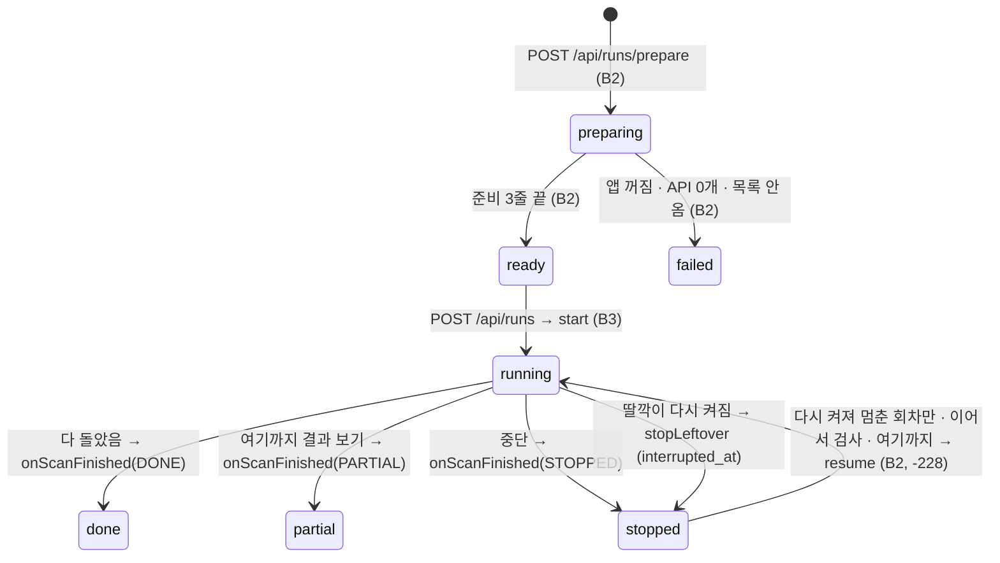

# 검사 회차 흐름 · 코드 연결 설계

> **담당** · B2 · S15P31A107-159 · 10/31까지 채우고 B3 · AI2 Approve
> 주고받는 JSON은 [openapi.yaml](openapi.yaml) 약속 ③④, 테이블은 [db.md](db.md) `run` · `run_score` · `run_issue` · `code_source`. 이 문서는 "어떻게 만드는가"만 쓴다

## 1. run 상태 전이

| 바뀜 | 누가 · 함수 | 같이 하는 일 |
| --- | --- | --- |
| → preparing | B2 `POST /api/runs/prepare` | run 줄을 만들고 runId를 바로 준다 (§2) |
| preparing → ready · failed | B2 준비 작업 | ready는 시나리오를 `ScenarioStore.save`(§7)에 저장한 뒤. failed는 준비 상태 `error`와 같이 |
| ready → running | B3 → `RunLifecycle.start(runId)` | started_at. 같은 서비스에 running 회차가 있으면("딸깍"을 두 번 눌러 이 회차가 이미 running인 것도) `ApiException(RUN_IN_PROGRESS)`, 없거나 ready · running이 아니면 `ApiException(NOT_FOUND)`. 확인과 바꾸기는 `synchronized` 하나로 묶어 동시에 두 번 불러도 하나만 running이 된다(서버가 하나라서. 여럿이 되면 DB 잠금으로) |
| running → done · partial · stopped | B3 → `RunLifecycle.onScanFinished(runId, end)` | 결과 정리 · 저장(§3 · §4 · §6)이 끝난 뒤 상태와 finished_at. 저장이 끝날 때까지 막히니(최대 약 2분 20초) B3 검사 스레드에서 부르고, 돌아오면 SSE `done` |
| stopped(다시 켜져 멈춤) → running | B3 `POST /api/runs/resume` · `/finish-partial` → `RunLifecycle.resume(runId)` (-228) | `interrupted_at`이 있고 그 서비스의 마지막 끝난 회차만(`RunLifecycle.interrupted`). 아니면 `ApiException(NOT_FOUND)`, 같은 서비스에 running이 있으면 `RUN_IN_PROGRESS`. finished_at · result_seen_at · interrupted_at을 비우고 resumed_at을 찍어(소요 시간 · 팀 서버 배포 대기는 이 시각부터, started_at은 처음 시작 그대로) running으로 저장한 뒤 B3가 검사 스레드를 띄운다 — 이어서는 끝난 시나리오를 건너뛰고, 여기까지는 도구 없이 결과 정리만(→ partial). 그 회차의 앱이 지금 연결돼 있는지(`SERVICE_OFFLINE`)는 이어서만 B3가 본다(scan.md §8-1) |

- 검사는 한 번에 하나다. `POST /api/runs/prepare`는 running 회차가 있을 때만 409 `RUN_IN_PROGRESS`. 준비만 하고 떠난 preparing · ready 회차는 그대로 두고, 이력 · 홈 지난 검사에는 done · partial · stopped만 나온다
- 결과를 정리하는 동안(`onScanFinished` 안)은 아직 running이다. 그동안 새 준비는 409
- 중단도 여기까지 모은 결과를 정리한다. 이력에 "중단"으로 남고 점수는 검사한 영역만 나온다
- 서버가 다시 켜지면 preparing → failed(준비 작업이 사라짐, `RunPrepare.failLeftover`), running → stopped · finished_at(도구가 사라짐 · 결과 정리 없이, `RunLifecycle.stopLeftover`). 이 회차는 `result_seen_at`도 같이 찍어 홈이 점수 없는 회차를 '검사 완료'로 보내지 않고(-214), `interrupted_at`을 찍어 홈이 "이어서 검사할까요?"를 묻는다(`run.state: interrupted`, -228). 사용자가 중단 · 여기까지를 고른 뒤 결과 정리(AI 해석) 중에 꺼진 회차(`stop_chosen_at`이 있음)는 `interrupted_at`을 찍지 않는다 — 일부러 멈춘 시나리오를 이어서 다시 돌리지 않게(!143 리뷰 3-3). 사용자가 고르기 전에는 다시 돌지 않는다. 이어서 · 여기까지를 고르면 위 표대로 running이 되고, 그 뒤에 같은 서비스의 다른 검사가 끝나면 더 묻지 않는다(그 회차는 점수 없는 "중단"으로 남는다). 둘 다 켜질 때(`ApplicationReadyEvent`) 한다. `ddalkkak reset-password`(살아 있는 서버 옆에서 같은 jar · 같은 DB로 한 번 더 뜸)로 뜬 경우는 지금 도는 회차라 바꾸지 않는다(-208). 남아 있던 도구 컨테이너는 같은 때 B3 `LeftoverTools`가 지운다(scan.md §2-1, -197)
- 상태는 DB · JSON에 소문자로 쓴다 (`RunStatus` enum)

## 2. 준비 (화면 3)

`POST /api/runs/prepare` (본문 없음, -224 전에는 `{codeJobId}`)

1. 바로 확인한다. `ServiceRegistry.current()`가 없거나 `connected: false` → 409 `SERVICE_OFFLINE` · running 회차 있음 → 409 `RUN_IN_PROGRESS`
2. run 줄(preparing · service_id · code_source_id)을 만들고 `{runId}`를 바로 돌려준다
3. 나머지는 뒤에서(가상 스레드) 돈다. 줄 3개의 상태는 메모리(runId → 줄 상태)에 두고 `GET /api/runs/prepare/{id}`가 그대로 읽는다. 서버가 다시 켜지면 사라져 404 → 화면은 홈(1)부터

| 줄 | 하는 일 | `detail` |
| --- | --- | --- |
| 1 코드 가져오기 | 저장한 방식(§5 맨 위)으로 새 code_source 줄을 만들어 다시 가져오고 끝나길 기다린다(`CodeJobs.await`, -224) | 끝 `GitHub main a3f9c1`(유형 · branch · 커밋, 모르는 칸은 뺀다 · jar 복원은 `실행 파일`) · 코드 없이 → 건너뜀 "코드 없이 진행" · 작업 실패 → 건너뜀 + 작업 오류 문구, 코드 없이 계속(회차의 code_source_id를 비우고 `hasCode: false`). 작업은 성공했는데 작업 폴더가 없으면(§5 정리 · 손으로 지움) 작업 실패와 같게 건너뜀 "잠시 후 다시 해 주세요"(`SERVER_ERROR` 문구) |
| 2 API 목록 받기 | `ApiCatalog.requestLatest(serviceId)` → snapshotId → `changed(snapshotId, baseSnapshotId)` · `endpoints(snapshotId)`. baseSnapshotId = 마지막으로 끝난 회차의 `run.snapshot_id`(없으면 null) — 준비만 하고 버린 회차의 스냅샷과 비교하면 그 사이에 생긴 API가 "바뀜 없음"으로 빠진다 | 끝 `14개 · 지난번보다 +1`(추가 − 없어짐, 음수는 `-2`, 0이면 `지난번과 같음`. 첫 검사는 `14개`) · 실패 → 준비 실패 |
| 3 시나리오 만들기 | 1 · 2가 끝난 뒤 `/ai/scenarios`(§3) → `ScenarioStore.save(runId, items)`(§7) | 끝 `성능 · 보안 · 코드 품질`(시나리오가 있는 영역만. AI 설정이 있는데 기본 시나리오가 와도 끝) · AI 설정 없음 → 건너뜀 "AI 연결 없음 · 기본 범위 사용"(AI 서버가 기본 시나리오를 준다) · 바뀐 API 없음 → 끝 "바뀐 API 없음 · 지난 항목 그대로"(지난 항목에 권한 점검이 없으면 바뀐 게 없어도 AI 서버를 부른다, -238) · "기본 범위로 바로 가기"(`POST …/use-default`) → AI 답을 기다리는 중이면 그 답을 버리고 키 없이 다시 불러 바로 건너뜀 "기본 범위 사용"(1 · 2줄 중이면 3줄에서 키 없이). 늦게 온 답은 저장하지 않는다. 끝남 · 실패 뒤엔 409 `PREPARE_ENDED` |

- 1과 2는 같이 돈다: API 목록 요청(`requestLatest`)을 먼저 보내 두고 코드 작업을 기다린다(clone을 기다리는 동안 API 목록도 받는다). 3은 코드 유무(`hasCode`)와 목록이 다 있어야 한다
- 첫 검사(이 서비스에 끝난 회차가 없음)는 `ApiCatalog.changed`를 부르지 않고 준비 상태 `apiDiff`가 null이다
- 3은 지난 항목을 이어 받기 전에 이번에 AI를 쓰는지(키가 있고 "기본 범위로 바로 가기"를 아직 안 눌렀을 때)를 지난 회차 때 AI를 쓰기로 했는지(`run.ai_asked`)와 비교한다. 다르면 지난 시나리오를 이어 받지 않고 처음부터(`full`) 만든다 — AI를 지우거나 "기본 범위로 바로 가기"를 눌렀는데 지난 AI 카드가 그대로 나오지 않게, AI 없이 첫 검사한 서비스에 AI를 연결하면 다음 준비에서 AI 카드가 생기게 (-252). `ai_mode`(응답 `source`)로 비교하지 않는다: 키를 실어 재검사(`changed`)를 불러도 AI 서버는 LLM 없이 `source: default`로 답하고(ai-server §2-4), AI 호출이 실패해도 `default`라서, 비교하면 AI를 연결한 채 API가 바뀐 재검사 한 번 뒤에 다음 재검사가 지난 선택을 버리고 LLM을 처음부터 다시 부른다. `ai_asked`는 3줄이 시작할 때 `useAi`로 남기고, "기본 범위로 바로 가기"로 끝나면 false다. 다만 키를 실은 `changed` 호출을 기다리던 중에 눌러 그 요청(`previous` = 지난 AI 카드)을 키만 빼고 다시 보내면 AI 서버가 지난 llm 카드를 이어 주니 true로 둔다(!161 리뷰 3-2). 1 · 2줄 중 누른 클릭은 이미 `useAi`에 들어가 있으니, 지난 회차도 AI를 안 썼으면(같으면) 지난 항목 그대로다(리뷰 4-1). 3줄 AI 호출 중에 눌러도 지난 회차가 AI를 안 썼으면 이번과 같으니, 3줄이 시작할 때 만들어 둔 "지난 항목을 실은 요청"으로 끝낸다 — 바뀐 것이 없으면 AI를 다시 부르지 않고 지난 항목 그대로(리뷰 5-1, B2 확인). 지난 회차가 AI 호출 실패로 `default`가 됐어도 `ai_asked`는 true라 바뀐 것이 없으면 이어 받는다(계속 실패하는 AI를 재검사마다 부르지 않는다)
- 3의 `mode`는 이 서비스에 끝난 회차가 없으면 `full`(목록 전체)이다. 있으면 `changed`이고(끝난 회차는 있는데 지난 시나리오가 하나도 없으면 이어 받을 것이 없으니 `full`), `apis`엔 `changed(snapshotId, baseSnapshotId)`에서 change가 new · changed인 API만, `previous`엔 지난 시나리오(`ScenarioStore.forApis`, §7)를 넣되 없어진(removed) API의 항목은 빼고 넣는다(AI 서버는 무엇이 없어졌는지 모른다, 약속 ②). apiDiff가 0 · 0 · 0이어도 코드를 새로 연결했거나 끊었으면(`hasCode`가 그 끝난 회차와 다름), 또는 코드가 있는데 지난 항목에 코드 품질(area `code`)이 없으면 `apis: []`로 AI를 부른다. AI 서버는 `hasCode: true`이고 `previous`에 코드 품질 항목이 없으면 코드 품질 시나리오를 새로 만들고, `hasCode: false`면 지난 코드 품질 항목을 뺀다([ai-server.md §2-4](ai-server.md), AI1 구현 -149). 한 번 코드 품질 없이 저장된 서비스도 다음 재검사에서 다시 부르니 -149 뒤에 저절로 생긴다. 권한 점검도 같다(-238): `previous`에 권한 점검(`ddalkkak` · `idCount`)이 없고 바뀐 API에 로그인 필요 `{id}` GET이 없으면, 바뀌지 않은 로그인 필요 `{id}` GET 하나(경로 변수가 끝에 하나뿐 · 호출 많은 순, AI 서버 `_id_gets`와 같은 규칙)를 `apis`에 더 실어 apiDiff가 0 · 0 · 0이어도 부른다. AI 서버는 그 API를 바뀐 API로 보고 카드를 새로 만들지만, 그 API를 대상으로 한 카드는 권한 점검만 받고 그 API의 지난 카드는 `reused: true`로 되살린다(키가 겹치면 받은 카드를 빈 번호로). 그 API로 간 기본 공격 범위는 버리지 않고 바뀐 API 중 호출 1위로 옮긴다(AI 서버는 `apis` 중 호출 1위에만 ZAP을 만든다, !149 리뷰). 권한 점검 없이 저장된 서비스(-231 전)도 다음 재검사에서 생긴다. 바뀐 것 없이 권한 점검 때문에만 부른 호출이 두 번 다 실패하면 준비를 실패로 끝내지 않고 지난 항목을 그대로 쓴다(3줄 "바뀐 API 없음 · 지난 항목 그대로") — 다음 재검사에서 다시 부른다(!149 리뷰). 그 밖에 apiDiff가 0 · 0 · 0이면 AI를 부르지 않고 지난 항목을 그대로 쓴다(F-PLAN-01). 이때는 지난 시나리오를 전부 `reused: true`로 `ScenarioStore.save`에 넘긴다 — AI가 붙이는 `reused` 표시가 없으면 save가 지난 선택을 이어 받지 못한다(F-SCOPE-07)
- run.ai_mode = `/ai/scenarios` 응답의 `source` (안 불렀으면 지난 회차 값). 준비 상태 `aiMode`는 3줄이 돌기 시작할 때 AI를 쓰면(AI 설정이 있고 "기본 범위로 바로 가기"를 아직 안 눌렀으면) `llm` · 아니면 `default`로 먼저 보여 주고(openapi 진행 중 예시), 응답이 오면 `source`로 바꾼다. 준비 실패면 null
- run.snapshot_id = 2줄에서 받은 snapshotId(`snap_12` → 12)
- 준비 실패(`done: true` + `error`, 회차 failed). 실패한 줄은 `skipped` + detail에 오류 문구, 그 뒤 줄은 `waiting` 그대로다 (2줄 실패 pct 40 · 3줄 실패 100)
  - 2줄 실패 → `SERVICE_OFFLINE`(앱 꺼짐) · `NO_APIS`(API 0개). `requestLatest`가 `ApiException`으로 끝나면 그 코드를 쓰고, 그 밖의 예외 · `ddalkkak.prepare.api-timeout`(50초) 안에 안 끝남은 `SERVICE_OFFLINE`, `endpoints`가 0개면 `NO_APIS`
  - 3줄 AI 서버 무응답 → `SERVER_ERROR`(1번 다시 해 본 뒤). 바뀐 것 없이 권한 점검 때문에만 부른 호출이면 실패 대신 지난 항목 그대로 끝(-238)
- `pct` = 줄 가중치 20 · 20 · 60의 합. 끝 · 건너뜀은 다, 진행 중은 반, 대기는 0으로 친다 (openapi 예시: 실패 40 · 진행 70 · 끝 100). `done`은 세 줄이 다 끝 · 건너뜀이거나 준비 실패

## 3. AI 서버 부르기

모든 호출은 `AiClient.call(path, body, type, timeout)`이다. 저장된 AI 설정이 있으면 `X-AI-*` 헤더를 붙이고, 없으면(또는 master.key를 잃어 못 풀면) 헤더 없이 부른다. 못 풀면 WARNING 한 줄(예외 종류만, 키 · 암호문은 남기지 않음)을 남기고, 같은 암호문이면 다시 남기지 않는다(-243).

| 호출 | 언제 | Spring 기다림 | 실패하면 (무응답 · 200 아님 · 형식 틀림) |
| --- | --- | --- | --- |
| `/ai/check` | AI 연결 확인 | 15초 | 다시 안 함 · "AI가 응답하지 않아요" (-127 구현) |
| `/ai/scenarios` | 준비 3줄 (바뀐 API도 코드 변화도 없고 지난 항목에 권한 점검이 있으면 안 부름, §2) | 70초 | 1번 다시 → 준비 실패 `SERVER_ERROR`(권한 점검 때문에만 부른 것이면 지난 항목 그대로, -238) |
| `/ai/reports` | `onScanFinished` · 6 "다시 해석" | 70초 | 1번 다시 → 저장 없이 상태만 바꿈 → 결과 `reportError: AI_UNAVAILABLE`. "다시 해석"은 다시 안 하고 503 `AI_UNAVAILABLE` |
| `/ai/prompts` | 6 · 7 수정 요청문 | 40초 | 다시 안 함 → 500 `SERVER_ERROR` (화면 "다시 생성"으로 다시) |

- **기본값은 AI 서버가 바꾼다.** 키 헤더가 없거나 LLM이 시간을 넘기거나 형식이 틀리면 AI 서버가 기본 시나리오 · 기본 설명 · 기본 틀(`source: default`)로 200을 준다. Spring에는 기본값 규칙이 없다. 위 "실패"는 AI 서버 자체가 답하지 않을 때뿐이다
- 요청 본문
  - scenarios
    - `service` = `ServiceRegistry.current()`의 name · framework(`Spring Boot 3.2`)
    - `hasCode` = 준비 1줄에 코드가 있음
    - `apis` = `ApiCatalog.endpoints()`를 ApiEndpoint 모양(`auth: {required, role}`)으로
    - `previous` = `ScenarioStore.forApis(serviceId)`(§7)의 지난 시나리오
  - reports: B3 `RawResults.of(runId)`를 그대로 보낸다 (모양은 B3 · AI2 약속 ③). B3 -134 전에는 빈 구현이 약속 ③ 요청 예시 값을 준다
  - prompts (`RunPrompts`, -146)
    - `framework` = 그 회차 `run.service_id` 줄의 framework(`Spring Boot 3.2`, 해제한 서비스여도 — db.md §4, -223). 모르면 `Spring Boot`
    - `issues` = 고른 run_issue를 ③ Issue 모양으로, 고른 순서 그대로(순서는 AI 서버가 다시 정한다). 같은 id를 두 번 골라도 한 번만
    - `code` = 1건이고 §6에서 위치를 찾았으면 {file, line, commit, branch, lines, decompiled}(7 문제 상세 `code`와 같은 값), 아니면 `null`. 2건 이상이면 항상 `null`
    - `logs` = `includeLogs: true`면 문제 순서대로 B3 `Repro.of(runId, itemKey).logs()`를 이어 붙인다(같은 시나리오 `itemKey`는 한 번만). 아니면 빈 목록
    - 요청문은 저장하지 않는다(F-PROMPT-05). 응답 `{source, text}` 중 `text`만 ④ 응답 `{text}`로 돌려준다
  - `POST /api/runs/{id}/prompts`의 오류: `issueIds`가 없거나 글자 배열이 아니거나 빈 글자가 섞이면 · `includeLogs`가 true · false · null(없음과 같이 false)이 아니면 400 `BAD_REQUEST`, 0개면 400 `NO_ITEMS`(`issueIds` 모양 → 0개 → `includeLogs` 순서로 거른다), 끝난 회차가 아니거나 이 회차에 없는 문제 id가 하나라도 있으면 404 `NOT_FOUND`(AI를 부르기 전에 거른다). AI 서버가 답하지 않거나 200이 아니거나 `text`가 없으면 다시 하지 않고 500 `SERVER_ERROR`
- 타임아웃은 `application.properties`의 `ddalkkak.ai.*-timeout`에 둔다 (`check-timeout` · `scenarios-timeout` · `reports-timeout` · `prompts-timeout`)

## 4. 결과 저장

`onScanFinished(runId, end)`와 "다시 해석"이 ③ 응답을 받으면 트랜잭션 하나로 저장한다. "다시 해석"은 그 회차의 run_score · run_issue를 지우고 다시 넣는다.

저장하는 함수는 `RunResults.save(runId, end, report, raw)`다(`run` 패키지 안, -128). `report`는 ③ 응답(`Report`), `raw`는 결과 원본 `results`(B3 `RawResults.of`)이고 시나리오 수(`results` 수)와 §6 코드 위치(`itemKey` · `api` · `findings`)에만 쓴다. 미검사 수 · 사유는 원본 `status` · `skipReason`이 아니라 ③ `summary`의 `skip` · `skipReasons`로 센다(아래 **run**). 영역(summary)이 하나라도 없거나 저장 중 하나라도 틀리면 아무것도 바꾸지 않는다. finished_at은 처음 저장할 때만 찍고, "다시 해석"으로 다시 저장해도 그대로 둔다.

**결과 정리 흐름** (`RunReports`, -136): `RawResults.of(runId)` → `AiClient.call("/ai/reports")`(`ddalkkak.ai.reports-timeout` 70초) → `RunResults.save`
- `onScanFinished`는 2번까지 부른다. 무응답 · 200 아님 · 형식 틀림(`scores`나 영역 `summary`가 빠짐)이면 1번 다시. 받은 ③ 응답과 결과 원본 `results`를 `save`에 넘긴다
- 두 번 다 안 되면 점수 없이 상태 end와 finished_at만 바꾼다(`reportError`는 읽을 때, 아래). 저장하다 틀린 것(롤백됨)도 같게 본다 — 회차가 running으로 남지 않게. 로그에는 남긴다
- `onScanFinished`는 running인 회차만 받는다. 없거나 running이 아니면 `ApiException(NOT_FOUND)`
- "다시 해석" `POST /api/runs/{id}/report`: 끝난 회차만(그 밖은 404). 같은 흐름을 한 번만 부르고(다시 안 함) 그 회차의 지금 상태로 저장해, 성공하면 갱신된 결과(`GET /api/runs/{id}`와 같은 모양)를 돌려준다. AI 서버가 답하지 않으면 503 `AI_UNAVAILABLE`이고 예전 결과는 그대로다
- ③ 응답에 모르는 칸이 있어도 받는다. `summary.{영역}.skip` · `skipReasons`가 없으면(옛 AI 서버 · ④ 예시) 미검사 0으로 본다

**run_score**: 영역(perf · sec · code)마다 1줄, 늘 3줄

| 컬럼 | ③ 응답 |
| --- | --- |
| score | `scores.{영역}` (미검사 null) |
| pass_count · fail_count | `summary.{영역}.pass` · `.fail` |
| summary_line | `summary.{영역}.line` |
| skip_reason | `summary.{영역}.skipReason` |
| passed | `passed[]` 중 그 영역의 `[{name, value}]` (JSON) |
| halted | `summary.{영역}.skipReasons`에 `중단됨`이 1 이상 (AI 서버가 B3의 `status: partial` 항목과 `skipped · 중단됨` 시나리오를 이 사유로 센다). 이력 태그에 쓴다 |

**run_issue**: `issues[]` 1건 = 1줄, 응답 순서 그대로 (7 화면 이전 · 다음도 이 순서)

| 컬럼 | ③ Issue |
| --- | --- |
| issue_key · item_key | `id` · `itemKey` |
| area · level · certainty | 그대로 |
| title · tech · impact · suspect_reason · cause · pass_criteria | 그대로 (TEXT) |
| penalty | 그대로 (INT, -247) |
| rule_id | `ruleId` (내부용, ④ 응답에는 안 실음. 코드 위치 예비 경로가 그 규칙의 발견만 고른다 — 없으면 위치 없음, 이전 회차는 tech "semgrep <ruleId>", -247) |
| where_text | `where` |
| as_is · to_be · metrics · fix | JSON 문자열 |
| location_file · location_line · code_lines | ③엔 없다 → §6에서 찾는다 |

**run** (같은 트랜잭션)
- scenario_count = 결과 원본 `results` 수 (검사한 카드 수, 미검사 포함)
- item_count = Σ(pass + fail + skip). `skip`(③ `summary.{영역}.skip`)은 원본의 `status: skipped`에 AI 서버가 미검사로 판정한 것(중단됨 · 미측정 · 결과 해석 실패 · 요청 구성 오류)을 더한 수라, 원본 skipped만 세면 멈춘 회차가 "미검사 0"이 된다
- skip_reason = 세 영역 ③ `summary.{영역}.skipReasons`(사유별 수)를 합쳐 가장 많은 사유, 같으면 먼저 나온 것 (홈 "미검사 N(사유)"). `summary.{영역}.skipReason`은 영역 전체가 미검사일 때만 채워져 회차 사유를 셀 수 없고, 원본 skipped를 따로 세면 같은 항목을 두 번 센다
- status = end, finished_at

**읽을 때**
- `reportError`는 따로 저장하지 않는다. 끝난 회차인데 run_score가 없으면 `AI_UNAVAILABLE`. 이때 `scores`는 모두 null, `summary`는 영역마다 `{line: "", pass: 0, fail: 0, skipReason: null}`, `issues` · `passed`는 빈 목록
- 결과(`GET /api/runs/{id}`) · 문제 상세는 끝난 회차(done · partial · stopped)만 읽힌다. 없거나 아직 안 끝난(preparing · ready · running · failed) 회차는 404 `NOT_FOUND`
  - `service` = 그 회차 `run.service_id` 줄의 name. 해제했거나 다른 서비스가 연결돼 있어도 그 회차의 서비스다(`ServiceRegistry.current()`가 아님, db.md §4, -223)
  - `at` = started_at, `durationMin` = started_at(이어서 검사한 회차는 resumed_at) → finished_at(분). `codeSource` = `{type, commit}`, code_source가 없거나 `none`이면 null
  - `passed`는 영역 순서(perf · sec · code)로 합쳐 준다. ③ 응답에서 영역이 섞여 있던 순서는 남기지 않는다
- 문제 상세(`GET /api/runs/{id}/issues/{issueId}`): `prev` · `next`는 저장 순서. `api` · `repro`의 사람 수 · 시간 · 모양 · 주소는 이 회차 검사 범위(`ScenarioStore.scope(runId)`, §7)에서 그 `itemKey` 시나리오를 찾아 읽는다 — `api` = 시나리오의 `api`, `usersFrom` · `usersTo` · `durationMin` · `shape` = `params`(사용자가 바꾼 값이 덮인 것, 숫자가 아니면 null), `repro.api` = 시나리오의 `api`. 범위에 그 시나리오가 없거나 코드 품질처럼 주소 · 사람 수가 없으면 그 칸은 null. `repro.testAccount` · `evidence`는 B3 `Repro.of(runId, itemKey)`의 테스트 계정 · 로그다(-137, B3 -134 전에는 빈 구현이 약속 예시 값을 준다). 주소는 검사 범위 시나리오의 `api`(쿼리 없음)다. 실제로 보낸 요청(공격 입력 · 쿼리)은 B3 `Repro.of` 관측 근거 로그에 실린다. `code`는 location_file · location_line이 있을 때만 나오고 commit · branch · decompiled는 회차 code_source에서 읽는다
- 이력(`GET /api/runs`): 지금 연결된 서비스(`ServiceRegistry.current()`, 해제한 줄은 빠짐)의 끝난 회차를 id 큰 것부터. `limit` 기본 20 · 최대 100
  - 연결된 서비스가 없으면(해제 뒤) 빈 목록(`total` 0)이다. 해제한 서비스의 회차는 지우지 않고, 결과(6)는 주소로 계속 열린다. 같은 앱을 다시 허용하면 그 service 줄을 다시 써서(F-CONN-04) 이력이 다시 보인다. 홈 지난 검사(`RunHistory.latest`)도 같은 기준이다 (-223)
  - `tags`: `최신`(가장 최근 끝난 회차) · `첫 측정`(가장 오래된 끝난 회차) · `일부 완료`(partial) · `중단`(stopped). 최신 · 첫 측정은 `limit`과 상관없이 서비스 전체 기준이다. 검사가 한 번뿐이면 `최신`과 `첫 측정`이 같이 붙고 `trend`는 한 칸이라 화면에 증감이 없다
  - `일부 완료`에는 멈춘 영역(run_score.halted)이 붙는다: `일부 완료 · 성능 중단됨`, 둘 이상이면 영역 순서(성능 · 보안 · 코드 품질)로 `일부 완료 · 성능 · 코드 품질 중단됨`. 멈춘 영역을 모르면(AI 서버가 `중단됨`을 세지 않았거나 옛 결과) `일부 완료`만. `중단`(stopped)은 사용자가 멈춘 것이라 영역을 붙이지 않는다. "다시 해석"으로 결과가 바뀌면 같이 다시 정해진다
  - 지난번 대비 증감(F-HIST-02)은 약속 ④에 칸이 없다. 화면이 `runs`로 계산한다 — 최신 회차 점수와 그 앞에서 마지막으로 잰 회차 점수를 비교하고, 미검사 회차는 건너뛰며 막대(`trend`) 밖 회차도 본다. 받은 목록(`limit` 기본 20) 안에 앞에 잰 회차가 없으면 첫 측정, 최신이 미검사면 증감 없음(-256)
  - `fixCount` = Σ fail_count. `codeSource` = `GitHub a3f9c1` (`GitHub` · `실행 파일` · `ZIP` · `내 컴퓨터` + 커밋), 코드 없이 검사했으면 null
  - `trend`: `limit`과 상관없이 최근 4번을 오래된 것부터. 점수를 못 받은 영역은 null
- 홈 지난 검사(`RunHistory.latest`)
  - `topDanger` · `topWarn` = 위험(주의)이 있는 영역마다 "영역 개수 · 그 영역 issue `tech`의 첫 조각(최대 2개)" 한 줄 (예 `성능 2 · N+1 의심 · 커넥션 풀 대기`), 성능 · 보안 · 코드 품질 순으로 줄바꿈(`\n`)해 잇는다 — 세 영역에 다 있으면 세 줄 (-214). 첫 조각은 중복을 빼고 글자 순으로 둔다
  - 홈 검사 상태(`RunHistory.state`, `Home.run`) = running 회차가 있으면 running · 마지막 끝난 회차에 `run.interrupted_at`이 있으면 interrupted(멈춘 단계 `interruptedAt`은 B3 `RawResults.stopPoint`, -228) · 그 회차의 `run.result_seen_at`이 비었으면 done · 그 밖 none. 다시 켜져 멈춘 회차는 result_seen_at이 찍혀 있어 interrupted를 먼저 본다. `GET /api/runs/{id}`가 처음 열 때 `result_seen_at`을 찍는다 (-214)
  - `passed` = Σ pass_count
  - `skipped` = item_count − Σ(pass + fail) · run.skip_reason
- 시각 칸은 TIMESTAMP(서버 시간대)로 저장하고 응답은 `+09:00`로 바꾼다

## 5. 코드 가져오기

**저장한 방식 · 검사 때 다시 가져오기** (-224 — 아래 표 · 정해 둔 것보다 이 절이 먼저다)
- 코드 연결은 0-3 ④에서 한 번 한다(`POST /api/code-source` · `/zip`). 가져오기에 성공한 가장 최근 줄이 **저장한 방식**이고 `GET /api/code-source`의 `last`다. ZIP · none도 저장한 방식이 된다
- `POST /api/runs/prepare`는 본문이 없다(`codeJobId`를 뺐다. 옛 화면이 보내도 읽지 않는다, -242). 준비 1줄이 저장한 방식을 복사한 새 code_source 줄을 만들어 같은 `CodeFetcher`로 다시 가져오고(`CodeJobs.await`로 기다림) run.code_source_id에 그 줄을 단다. github는 같은 주소 · 브랜치 · token_enc로 최신 커밋을, jar는 같은 경로를 다시 디컴파일, local은 다시 복사, zip은 보관한 파일을 다시 푼다. 저장한 방식이 없거나 none이면 1줄은 건너뜀 "코드 없이 진행"
- 다시 가져오기에 실패하면(저장소 접근 실패 · jar/war 없음 · 보관한 ZIP 없음 — 문구는 `ZIP_INVALID` "압축을 풀 수 없어요") 1줄은 건너뜀 + 작업 오류 문구이고 코드 없이 계속한다(지금 작업 실패와 같다). 실패한 줄은 저장한 방식을 바꾸지 않는다
- **ZIP 보관**: 올린 ZIP을 `~/.ddalkkak/code/{serviceId}/source.zip` 하나로 둔다(새로 올리면 바꾼다). 풀기에 실패한 ZIP은 보관하지 않는다
- **소스 식별자**: 회차의 code_source 줄에 커밋(last_commit) · 대상(ref) · 파일 해시(file_hash = ZIP · jar · war sha256 앞 12자)가 남고, 결과 `codeSource`가 그대로 보여 준다
- **WAR**: jar 타입에서 ref가 `.war`로 끝나면 `WEB-INF/classes`만 꺼내 디컴파일한다(`WEB-INF/lib`는 복원하지 않음). 커밋은 `WEB-INF/classes/git.properties`
- **디컴파일 후보** (`GET /api/code-source/artifacts`, F-CODE-05): 스타터킷이 hello로 보낸 `artifact`(실행 중인 jar · war) · `workDir`(user.dir)을 service 줄에 두고, 그 파일 하나와 작업 폴더 아래 3단계의 `*.jar` · `*.war`만 본다(`.git` · `node_modules` · `.gradle` 건너뜀, 최대 50개). `/host-home`으로 바꾼 `workDir`이 홈 밖(예 `user.dir`이 `/` · `/opt/app`) · 홈 자체 · `~/.ddalkkak` 아래면 폴더는 찾지 않고 `artifact` 한 줄만 본다(서버 컨테이너의 `/`를 훑지 않게, !127 리뷰). 경로는 아래 "내 컴퓨터와 jar 경로"처럼 `/host-home`으로 바꿔 읽고, 홈 밖 · `~/.ddalkkak` 아래 · 읽을 수 없는 파일은 `readable: false` + 이유. 서버는 컨테이너라 호스트 프로세스를 직접 보지 않는다

`POST /api/code-source`(ZIP은 `/zip`)가 code_source 줄을 새로 만들고 코드 작업을 뒤에서(가상 스레드) 돌린다. `jobId`는 `job_<code_source id>`다. 작업 상태는 메모리에 두고 `GET /api/code-source/jobs/{jobId}`가 읽는다(서버가 다시 켜지면 사라져 404). 끝나면 last_commit · last_commit_at · last_fetched_at · decompiled를 그 줄에 쓴다. 가져올 때마다 새 줄이라 지난 회차의 커밋이 이력에 남는다. 코드는 `server/…/code`(`CodeJobs` 작업 · `CodeFetcher` git · jar · ZIP · 폴더 · `CodeLocator` §6 · `CodeWorkspace`).

**정해 둔 것** (-144)
- `POST /api/code-source`는 주소 · 경로 모양만 바로 확인한다: 종류가 github · jar · local · none이 아니거나 ref가 비거나 칸(code_source.ref 512자 · branch 100자 · 암호화한 token 1024자)보다 길면 400 `BAD_REQUEST`, github 주소가 https 저장소 주소가 아니거나(`ddalkkak.code.git-schemes`, 기본 `https`) 비밀번호가 든 주소(`https://user:pw@…`)면 400 `CODE_URL_INVALID`(토큰은 token 칸으로), branch가 옵션처럼 보이면(`-`로 시작 등) 400 `BAD_REQUEST`. 연결된 서비스가 없으면 409 `SERVICE_OFFLINE`. 나머지 실패는 작업 `error`로 나온다
- branch를 비우면 저장소 기본 브랜치를 받고, 받은 브랜치 이름을 code_source.branch에 쓴다
- **커밋은 앞 7자리**로 쓴다(`git rev-parse HEAD`의 앞 7자 · jar의 `git.commit.id.abbrev`와 같은 길이). 비교는 짧은 쪽 길이만큼 앞에서부터라 길이가 달라도 된다
- `GET /api/code-source`의 `last` = 이 서비스에서 **가져오는 데 성공한**(last_fetched_at이 있는) 줄 중 가장 최근 것(-224부터 ZIP · none 포함). 실패한 줄은 빼고, 하나도 없으면 `last: null`(홈 "딸깍 검사" → 0-3 ④). 토큰은 응답에 없다
- 같은 주소로 **가져오는 데 성공한**(last_fetched_at이 있는) 줄이 있으면 token이 비어 와도 그중 가장 최근 줄의 token_enc를 이어 쓴다(주소가 다르면 이어 받지 않는다). 실패한 줄(오타 토큰)은 화면의 "이전 설정"이 아니라 건너뛴다. 빈 문자열도 비어 온 것으로 본다
- 작업 `error`: git 실패(주소 · 토큰 · 시간 초과) `CODE_FETCH_FAILED` · 저장소에는 닿았는데 브랜치가 없음 `CODE_BRANCH_NOT_FOUND`(-250, git 출력 `Remote branch … not found` — `LC_ALL=C`로 영어 출력) · 저장소 주소가 https가 아님 `CODE_URL_INVALID`(POST 400) · ZIP이나 jar가 깨짐 `ZIP_INVALID` · 홈 밖 경로 `CODE_PATH_INVALID`(아래) · 그 밖 `SERVER_ERROR`(Vineflower 실패 등). 실패한 작업의 폴더는 지운다
- ZIP은 올릴 때 바로 ZIP인지, 작업 폴더 밖을 가리키는 항목이 없는지, 비지 않았는지 본다(아니면 400 `ZIP_INVALID`). 푸는 중에 깨지거나 `../`가 나오거나 같은 이름의 파일과 폴더(`a` · `a/b.txt`)가 같이 들어 있어도 작업 `error` `ZIP_INVALID`다. 푼 크기는 제한하지 않는다
- 내 컴퓨터는 링크를 따라가지 않고 건너뛴다. `build/` · `target/`은 `src/` 아래에서는 빼지 않는다(패키지 이름일 수 있다).
- jar는 `BOOT-INF/classes`가 있으면 그 안만, 없으면 jar 전체를 임시 폴더에 꺼내 Vineflower에 넘긴다(`java -jar <vineflower> <꺼낸 폴더> <작업 폴더>`). 변수 이름 · 줄 번호는 복원 기준이다
- 설정(`application.properties`): `ddalkkak.code.work-dir`(기본 `~/.ddalkkak/work`. 내 컴퓨터는 `~/.ddalkkak` 아래만 막으니 바꿔도 그 아래에 둔다 — 밖에 두면 그 위 폴더를 고를 때 작업 폴더를 다시 복사한다) · `ddalkkak.code.host-home`(`HOST_HOME`, 없으면 이 컴퓨터의 홈) · `ddalkkak.code.home-mount`(`HOME_MOUNT`, 홈을 붙인 서버 안 자리. 비면 바꾸지 않음) · `ddalkkak.code.vineflower`(`/opt/vineflower.jar`) · `ddalkkak.code.git-schemes`(`https`, 시험만 file을 더한다) · `ddalkkak.code.fetch-timeout`(10분) · 올리기 한도 200MB

| type | ref | 하는 일 (CodeJob `step`) | 커밋 |
| --- | --- | --- | --- |
| github (GitHub · GitLab) | https 저장소 주소 + branch | `git clone --depth 1 --branch <branch> <주소> <작업 폴더>` (cloning) | `git rev-parse HEAD` · `git log -1 --format=%cI` |
| jar | 설치한 컴퓨터의 jar · war 절대 경로(후보에서 고름) | war면 `WEB-INF/classes`, jar면 `BOOT-INF/classes`(일반 jar면 전체)만 꺼내 `java -jar /opt/vineflower.jar <classes> <작업 폴더>` (extracting → decompiling). 라이브러리(`BOOT-INF/lib`)는 복원하지 않는다. decompiled = true | jar 안 `git.properties`의 `git.commit.id.abbrev`, 없으면 null |
| zip | 올린 파일 이름 | 작업 폴더에 푼다 (extracting). 파일은 보관해 검사 때 다시 푼다(-224) | 폴더에 `.git`이 있으면 github와 같게, 없으면 null |
| local ("내 컴퓨터") | 설치한 컴퓨터의 폴더 절대 경로 | 작업 폴더로 복사한다 (linking). `.git`은 두고 `build/` `target/` `node_modules/` `.gradle/`은 뺀다 | **원래 폴더**에서 위로 올라가며(홈 자체는 빼고) 처음 만난 `.git`으로 github와 같게 + 브랜치 `git rev-parse --abbrev-ref HEAD`(분리된 HEAD면 null). 저장소의 하위 폴더(모노레포의 앱)를 골라도 읽는다(-204). 없으면 null |
| none | — | 작업 없음 · `jobId: null` | — |

서버 이미지(`server/Dockerfile`)에 git과 Vineflower 1.12.0(`/opt/vineflower.jar`)이 들어 있다. 서버는 둘을 프로세스로 부른다.

**"내 컴퓨터"와 jar 경로**
- 둘 다 **딸깍을 설치한 컴퓨터(고객 앱이 같이 도는 컴퓨터)의 절대 경로**다. Windows(`C:\Users\me\proj`) · Mac(`/Users/me/proj`) · Linux(`/home/me/proj`) 모양 그대로 받는다. 브라우저는 사용자 PC의 실제 경로를 서버에 주지 못한다
- 설치기 · compose가 그 컴퓨터의 홈을 서버 컨테이너의 `/host-home`에 읽기 전용으로 붙이고, 홈 경로 글자를 `HOST_HOME`(`ddalkkak.code.host-home`)에, 붙인 자리를 `HOME_MOUNT=/host-home`(`ddalkkak.code.home-mount`)에 넣는다(-207. 예전 -166은 홈을 같은 경로로 붙였다)
  - 서버는 적힌 경로의 `\`를 `/`로 바꾸고, 앞이 `HOST_HOME`과 같으면(드라이브 문자가 있으면 대소문자 무시) 그 앞자리를 `/host-home`으로 바꿔 읽는다. `HOME_MOUNT`가 비어 있으면(개발 PC의 `bootRun`) 바꾸지 않는다
  - 바꾼 경로가 절대 경로가 아니거나 없거나, 홈 폴더 밖이거나(`..` · 링크로 나가는 것 포함), 홈 폴더 자체이거나, 홈의 `.ddalkkak` 아래(compose의 작업 폴더 · `master.key`)이면 작업 `error` `CODE_PATH_INVALID` "홈 폴더 아래에 있는 경로를 적어 주세요"(-144에서 api.md · openapi에 넣었다. 코드명 · 문구는 B4가 화면에서 본 뒤 고칠 수 있다)
  - 홈 안을 **절대 경로로 가리키는 링크**(`~/proj -> /home/me/work/proj`)는 따라가지 못해 `CODE_PATH_INVALID`다. 서버 안에서 홈이 `/host-home`에 붙어 있어 링크가 가리키는 `/home/me/…`가 없기 때문이다. 실제 경로(`/home/me/work/proj`)를 적으면 되고, 상대 경로 링크(`proj -> work/proj`)는 된다. 설치기 · compose(팀 서버) 모두 같다 — 예전 compose(-166)는 홈을 같은 경로로 붙여 됐다(-207 리뷰, 11/5 사용자 결정)
- 읽기 전용이고 홈만 연다. 서버 컨테이너는 이미 도커 소켓(호스트 root와 같은 권한)을 가지고 있어 새로 생기는 권한은 없다
- 설치 명령에서 홈을 붙이지 않으면 이 두 가지만 `CODE_PATH_INVALID`이고 GitHub · ZIP은 된다

**토큰** (비공개 저장소)
- code_source.token_enc에 `Secrets.encrypt`로 넣는다. "이전 설정과 동일"로 같은 주소를 보내고 token이 null이면 그 주소로 마지막으로 성공한 줄의 token_enc를 이어 쓴다
- git에는 주소 · 인자에 넣지 않고 환경변수로 넘긴다
  - `GIT_CONFIG_COUNT=1` · `GIT_CONFIG_KEY_0=http.extraHeader` · `GIT_CONFIG_VALUE_0=Authorization: Basic <base64("oauth2:" + 토큰)>` (GitHub · GitLab 둘 다 된다)
  - 프로세스 목록 · 로그 · 오류 문구에 토큰이 남지 않는다
  - `GIT_TERMINAL_PROMPT=0`로 비밀번호를 묻지 않고 바로 실패하게 한다
- clone 실패 → 작업 `error` `CODE_FETCH_FAILED`(없는 브랜치면 `CODE_BRANCH_NOT_FOUND`, -250). git 오류 출력은 서버 로그에만 남긴다
- ZIP 항목 이름은 `\`를 `/`로 바꾼 뒤 `/`로 끝나면 폴더로 본다 — Windows PowerShell 5.1 `Compress-Archive`는 `src\main\`처럼 역슬래시로 쓴다(-250)

**작업 폴더**
- `~/.ddalkkak/work/{serviceId}/{codeSourceId}/`. 가져올 때마다 새 폴더라 검사 중인 회차의 코드를 새로 가져온 코드가 덮지 않는다. 가져오기 전에 그 폴더를 비운다 — DB만 지우면(`docker compose down -v`) id가 1부터 다시 시작해 같은 번호의 옛 폴더가 남아 있다
- 가져오기가 끝나면(성공이든 실패든) 같은 서비스에서 그 작업보다 앞(id가 작은) 폴더 중 지금 도는 작업 · preparing · ready · running 회차가 쓰지 않는 것을 지운다. 뒤 폴더는 두어, 느린 clone이 도는 동안 다른 종류로 바꿔 가져온 폴더를 늦게 끝난 clone이 지우지 않는다. 끝난 회차의 코드는 §6이 저장해 둔 위치로 남아 폴더가 없어도 된다
- 그래도 준비할 때 고른 작업의 폴더가 없으면(앞 작업을 골라 둔 채 뒤 작업이 끝남 · 손으로 지움) 준비 1줄은 건너뜀 "잠시 후 다시 해 주세요"로 코드 없이 계속한다(§2)
- `CodeWorkspace.dir(runId)` = 그 회차 code_source의 폴더. 코드 없이 검사했거나(type `none` 포함) 폴더가 없으면(정리됨) empty
- 검사 도구 컨테이너(Semgrep)가 이 폴더를 붙일 때 쓰는 호스트 경로는 B3 [scan.md §2](scan.md#2-도구-컨테이너)
- ZIP 업로드 한도는 `spring.servlet.multipart.max-file-size` · `max-request-size` 200MB (기본 1MB). 넘으면 413 `BAD_REQUEST`(로그인 확인보다 먼저)이고, 크게 넘으면 Tomcat이 응답 없이 연결을 끊는다 — 화면이 올리기 전에 크기를 본다. 연결된 서비스가 없으면 409 `SERVICE_OFFLINE`. 풀 때 작업 폴더 밖을 가리키는 항목(`../`)이 있으면 `ZIP_INVALID`

**실행 중 버전과 비교 (F-CODE-03)**: `sameVersion`은 가져온 커밋과 `ServiceRegistry.current()`의 `runningCommit`을 짧은 쪽 길이만큼 앞에서부터 비교한다. 둘 중 하나라도 없으면 null.

## 6. 코드 위치 찾기

결과를 저장할 때(§4) 회차에 코드가 있으면 issue마다 파일 · 줄을 찾아 run_issue에 넣는다. 화면은 저장된 값만 읽으니 작업 폴더가 바뀌어도 지난 회차의 7 화면이 그대로다.

| 영역 | 어디서 찾나 |
| --- | --- |
| code | 결과 원본에서 그 `itemKey`의 findings 중 첫 `error`(없으면 첫 `warning`)의 `location`. AI2가 issue를 만드는 규칙과 같다 |
| perf · sec | 그 항목의 `api`(`GET /api/orders`) → `ApiCatalog.endpoints(snapshotId)`의 `handler`(`OrderController#list`) → 작업 폴더에서 `OrderController.java`를 찾고, 그 안에서 `list(` 메서드 선언 줄 |

- 성능 · 보안은 B1 API 목록의 handler(컨트롤러 메서드) 선언 줄이다. 서비스 메서드(`OrderService`)까지 따라가는 것은 B1 목록에 handler가 부르는 대상이 생기면 붙인다
- location_file = 작업 폴더 기준 상대 경로, location_line = 줄 번호, code_lines = 그 줄의 앞 2줄 · 뒤 3줄. 줄 번호를 붙인다(`"12    public List<Order> list(int page) {"`). 만드는 법: 그 창에서 공통 들여쓰기를 걷어 내고(탭은 공백 4칸) `줄 번호 + 공백 4칸 + 코드`로 쓴다. 빈 줄은 번호만 쓴다
- 비밀값 규칙(ruleId에 `secret` · `hardcode` · `credential` · `password` · `token` · `private-key`. 단 `md5-used-as-password`처럼 `used-as-password`는 약한 해시라 빼고 코드를 보여 준다)에 걸린 위치면 code_lines를 가려서 저장한다(NF-05, -187). 한 줄에 규칙이 여럿 걸려 where로 찾았으면 그중 하나라도 비밀값 규칙일 때 가린다. 화면 7과 `/ai/prompts`는 저장된 값을 그대로 쓰고 AI 서버는 다시 거르지 않는다. Semgrep이 가리킨 줄과 주석 줄(`//` · `/*` · `*` · `#`로 시작, 앞뒤 어느 줄이든), 보여 주는 줄 안에서 연 `/* … */` 안 줄은 줄 전체를 `****`로 한다(정규식 규칙은 주석의 맨 토큰에도 걸린다). 코드 뒤에 붙은 주석은 따옴표 안을 가린 뒤 따옴표 밖 `//` · `/*` · `#` 뒤를 줄 끝까지 `****`로 한다. 나머지 줄마다: 따옴표 안은 `"****"`(빈 문자열 `""` 포함, 텍스트 블록 구분자 `"""`는 그대로)이고, 따옴표 밖 `=` · `:` 뒤 값도 `;`나 줄 끝까지 `****`(몇째 줄이든. 주석의 `key=…` · `-u bot:…` · `password: 여러 단어`). 보여 주는 줄 안에서 연 텍스트 블록 안 줄은 앞줄도 줄 전체를 `****`, 그 블록을 닫는 줄은 `"""` 앞을 `****`. 따옴표가 없으면 가리킨 줄 앞은 첫 `=` · `:` 뒤를 `****`로 하고, 가리킨 줄 뒤는 줄 전체를 `****`로 한다(개인 키 · 텍스트 블록처럼 여러 줄에 걸친 비밀값). 줄 번호는 남긴다
- 자바 파일(`.java`)만 찾는다. Semgrep `location.file`이 작업 폴더 기준 경로면 그 파일, 파일 이름만 있으면 같은 이름 파일(src/main이 든 것 먼저)에서 찾고, 작업 폴더 밖을 가리키거나 줄이 파일보다 길면 못 찾은 것이다
- `handler`에 클래스만 있고 메서드가 없거나(`OrderController#`) 파일에 그 이름의 선언이 없으면 못 찾은 것이다. `return list(...)` 같은 호출 줄은 선언으로 치지 않는다
- 이미 정리돼 작업 폴더가 없을 때 "다시 해석"을 하면 그 시나리오(itemKey)가 지난번에 찾아 둔 위치를 그대로 둔다
- 같은 이름의 파일이 여럿이면(handler에 패키지가 없다) 경로에 `src/main`이 들어간 것 중 처음 것을 쓴다. 메서드가 오버로드돼 있으면 첫 선언을 쓴다
- 7 화면 `code` = {file, line, lines} + 회차 code_source의 commit · branch · decompiled. jar 복원이면 decompiled = true → "디컴파일 기준"
- 코드가 없거나 파일 · 메서드를 못 찾으면 세 칸 다 null → `code: null` (접힘 숨김)

## 7. 검사 범위 (화면 4)

10/31 B3에서 B2로 옮겼다(S15P31A107-130 · -138). 테이블 `scenario_item` · `run_scope`, 패키지 `server/…/scope`. 기능은 F-SCOPE-01~07, API는 `GET · PUT /api/runs/prepare/{id}/scope`

- `scenario_item` = 이 서비스에서 만든 시나리오 전부. **한 번 넣은 줄은 바꾸지 않는다.** 지난 회차의 `run_scope`가 가리키므로 고치지도 지우지도 않는다. 재검사에서 바뀐 API의 시나리오는 키(`perf-2`)를 이어 받아 새 params로 오고, 없어진 API의 키가 새 API에 다시 붙기도 한다(`ai/plan/defaults.py` `changed_items`). 그래서 같은 (service_id, item_key)의 줄이 여럿일 수 있고, 회차마다 그 회차의 `run_scope`가 가리키는 줄이 그 회차의 시나리오다. 덮어쓰면 지난 회차의 범위 · "다시 해석"의 통과 기준(`raw_result`에는 params가 없어 `scope(runId)`에서 받는다) · 7 화면 재현 조건이 새 값으로 바뀐다
- `run_scope` = 이 회차가 쓰는 시나리오와 사용자가 바꾼 값(`params`는 바꾼 칸만), 재검사에서 지난 시나리오를 그대로 쓴 것인지(`reused`, 응답 필수 칸). 회차의 검사 계획 = 그 회차의 `run_scope` 줄 전부

| 함수 | 하는 일 |
| --- | --- |
| `ScenarioStore.save(runId, items)` | §2의 3단계 끝에 부른다. `reused: true`인 시나리오는 지난 회차(`forApis`가 읽은 회차) `run_scope`에서 같은 item_key가 가리키던 `scenario_item` 줄을 다시 가리키고, 그 밖(새로 만든 · 바뀐 API의 시나리오)은 늘 새 줄을 넣는다. 그다음 이 회차의 `run_scope`를 만든다. included 기본값 = `recommended && !excluded`, 재검사에서 `reused: true`인 시나리오는 지난 회차의 included · params를 이어 받는다(F-SCOPE-07). `reused: true`인데 지난 회차에 같은 item_key가 없거나 그 줄이 GET이 아닌 성능 시나리오면 새 줄을 넣고 `reused`는 받은 값 그대로 둔다. GET이 아닌 성능 시나리오(api 첫 낱말을 대소문자 · 앞 공백 없이 봄, `ai/plan/filtering.py`와 같다)는 넣지 않는다(NF-07, -177). 같은 회차에 다시 부르면 그 회차 `run_scope`만 새로 만들고, 앞서 넣은 `scenario_item` 줄은 어느 회차도 가리키지 않은 채 남는다(지우지 않는다) |
| `ScenarioStore.forApis(serviceId)` | 끝난 회차 중 마지막 회차의 `run_scope` 시나리오 → §3 `previous`. `ScenarioStore`는 이번 회차의 API 목록을 모르니, 없어진 API의 시나리오는 부르는 쪽(§2의 3단계)이 `ApiCatalog.changed(snapshotId)`의 removed로 뺀다 |
| `ScenarioStore.scope(runId)` | included인 시나리오와 params(사용자가 바꾼 값을 위에 덮은 것) → B3 실행([scan.md §1](scan.md)) |

- `PUT .../scope`는 바뀐 것만 받고, 받은 뒤 범위 전체를 다시 계산해 돌려준다. ready인 회차만 바꾸고 그 밖은 404 `NOT_FOUND`. 영역 스위치 → 카드 → 직접 추가 순서로 적용하고, 안 맞으면 아무것도 저장하지 않는다. 칸이 그 도구의 것이 아니거나 숫자가 범위 밖이거나 ddalkkak 카드에 원래 종류가 아닌 칸이 오면 400 `BAD_REQUEST`, 시작 > 끝이면 400 `INVALID_RANGE`, 직접 추가의 대상이 이번 API 목록에 없거나 비거나 성능인데 GET이 아니면 400 `NO_TARGET`, 포함된 시나리오가 0개면 400 `NO_ITEMS`
- 설정 팝업 값(F-SCOPE-03 · 04, 10/31 -138)은 카드의 `params`에서 바꾼 칸만 온다. 세기 4단계 · "AI 추천으로" · "도구 기본값으로"는 openapi 요청에 따로 칸이 없어 화면이 숫자로 풀어 보낸다(예: 세게 = `usersFrom` 100 · `usersTo` 500). 서버는 도구마다 정한 칸과 범위만 받는다: k6 `usersFrom` · `usersTo` 정수 10–2000, `durationMin` 정수 1–30, `shape` constant · ramp · spike · step, `failP95Ms` 정수 1 이상, `failErrorRate` 0–1 / zap `range` default · wide · full / semgrep `severity` critical · major · all / ddalkkak `count` 정수 1–5 · `idCount` 정수 1 이상 — 카드는 원래(`scenario_item.params`) 칸만 받아 권한 점검 카드에 `count`, 테스트 계정 카드에 `idCount`가 오면 `BAD_REQUEST`(합친 값에 두 칸이 같이 남지 않는다, -188). 합친 값이 시작 > 끝이면 `INVALID_RANGE`(시작 = 끝은 된다). 카드의 `params`는 AI 값 위에 바꾼 값을 합친 것이고, 합치기 전 AI 값(`scenario_item.params`)은 `aiParams`로 같이 준다. "AI 추천으로"는 이 값을 쓴다. 직접 추가 카드는 null (-180)
- 영역 스위치를 끄면 그 영역 카드가 모두 빠진다. 켤 때 그 영역에 포함된 카드가 하나도 없으면 AI 추천 카드(`recommended && !excluded`)를 되살린다. 되살릴 추천 카드가 없으면(AI가 다 뺐으면) 그 영역 카드를 모두 넣는다. 화면은 스위치를 켜면 그 영역 카드를 전부 켜고 카드를 하나라도 켜면 스위치를 따라 켜서(F-SCOPE-02, -252) 카드마다 `included`를 같이 보내니 이 되살리기는 카드가 따로 안 오는 호출에만 쓰인다
- 코드 없는 회차(`code_source_id` 없음 또는 type `none`)는 코드 품질 영역이 OFF "코드 없음"
- 직접 추가(F-SCOPE-05)는 `source: manual`, why "직접 추가한 시나리오", item_key는 그 회차 범위의 그 영역에서 비어 있는 가장 작은 번호(perf-1 · perf-4가 있으면 perf-2). 같은 회차의 PUT은 run 줄을 잠가(`RunLookup.lock`) 하나씩 처리하니 두 번 클릭 · 탭 두 개로 동시에 와도 키가 겹치지 않는다. 늘 새 `scenario_item` 줄이고, `recommended: true`로 넣어 다른 카드처럼 포함된 채 시작한다. 영역이 도구를 정한다: 성능 k6 · 보안 zap(권한 점검 · 테스트 계정은 AI가 만든다) · 코드 품질 semgrep. 성능 · 보안의 대상은 `api`이고 이번 회차의 API 목록(`ApiCatalog.endpoints(run.snapshot_id)`)에 "메서드 경로"로 있어야 한다. 성능은 GET만 된다(k6 부하가 고객 앱 데이터를 만들거나 지우지 않게, NF-07). 보안은 쓰기 API도 된다. 코드 품질의 대상은 `target`이고 `api`는 버린다. 대상이 없거나 비면 `NO_TARGET`. 코드 없는 회차에는 코드 품질을 추가할 수 없다(400 `BAD_REQUEST`) — 그 영역은 OFF "코드 없음"으로 고정이라 받으면 "추가했어요" 뒤에 검사되지 않는 카드만 남는다. `params`에서 안 보낸 칸은 도구 기본값(k6 50→200명 · 3분 · ramp · 500ms · 1%, zap default, semgrep major)으로 채운다
- 지난 선택 기억(F-SCOPE-07): 직접 추가한 시나리오도 다른 시나리오와 같다. `forApis`가 지난 회차 `run_scope`의 시나리오 전부(source manual 포함)를 `previous`로 주고, AI 서버가 `reused: true`로 돌려주면([ai-server.md §2-4](ai-server.md)) `save`가 그 줄을 다시 가리키며 지난 included · 바꾼 params를 이어 받는다. AI를 부르지 않는 재검사(§2)는 전부 `reused`로 저장한다. 알려진 한계: 직접 추가한 시나리오의 대상 API가 바뀌었으면 AI가 새로 만들어 AI 추천부터 다시 시작하고 manual 표시도 사라진다
- 호출 수 이유(-218): 다시 가리킨 줄의 why는 첫 검사 때 호출 수다. 그래서 범위를 보여 줄 때(`GET · PUT …/scope`, `scope(runId)`) why가 AI 기본 성능 문구("호출이 N번으로 GET 중 K번째로 많아요", [ai-server.md §2-2](ai-server.md))이면 그 회차 목록(`ApiCatalog.endpoints(run.snapshot_id)`)의 호출 수 · GET 순위(호출 많은 순, 같으면 [ai-server.md §2-2](ai-server.md) 성능과 같은 순서 — `ScenarioStore.byCalls`)로 숫자를 다시 채운다. 첫 검사 때 호출이 0번이라 고른 기준 문구("호출 기록이 아직 없어 …")를 썼으면 이것도 숫자로 바꾼다(이번에도 0번이면 그대로, -151). 줄은 바꾸지 않는다. 바뀐 API만 받은 AI가 그 API끼리 매긴 순위도 이걸로 맞는다. 카드 번호와 대상은 지난번 그대로라 "perf-1 · GET 중 3번째"처럼 어긋날 수 있다. LLM이 쓴 why는 재검사에서 LLM을 부르지 않으니 첫 검사 때 숫자 그대로다
- 예상치(F-SCOPE-06)는 포함된 성능 시나리오마다 (시작+끝)÷2 × 분 × 60 × 1.6을 더하고, 부담은 성능 시나리오 끝 사용자 중 가장 큰 값으로 정한다(80 이하 낮음 "운영 서버도 괜찮아요" / 300 이하 중간 "개발 서버 권장" / 700 이하 높음 · 그 위 매우 높음 "운영 서버에서는 피하세요"). 보안 · 권한 점검 요청 수는 예상 요청 수에 넣지 않는다. `durationMin` = 포함된 성능 시나리오의 분 합계 + 보안 · 코드 시나리오 1장당 1분 (10/31 -130에서 정함)
- `ScenarioStore`는 B2 안에서만 Repository를 쓰고, B3는 `scope(runId)`만 부른다(지킬 규칙 3). 직접 추가의 대상을 고르는 이번 회차 API 목록은 B1의 `ApiCatalog.endpoints`로만 읽는다. 화면 4 "+ 추가"의 대상 후보도 같은 목록을 `GET …/apis`(-179)로 준다 — 카드가 없는 API까지 전부, `change`는 화면 3 `apiDiff`와 같은 기준(마지막으로 끝난 회차)이고 목록을 아직 못 받은 회차는 빈 목록

## 정할 것

| 무엇 | 누구와 | 언제 |
| --- | --- | --- |
| `ServiceRegistry.ConnectedService`에 framework(`Spring Boot 3.2`)를 추가해 `/ai/scenarios`의 `service.framework`와 `/ai/prompts`의 `framework`에 쓴다 (-133은 `Spring Boot`로 보낸다) | B2 | 정함 · -181 |
| `ApiCatalog.requestLatest`가 `ApiException(SERVICE_OFFLINE · NO_APIS)`로 끝나면 준비 실패 `error`에 그대로 쓴다 (-133은 그렇게 읽고, -181의 `ApiCatalog`가 이 예외로 끝낸다) | B2 | 정함 · -181 |
| 3 "AI 추천 없이 기본 범위로 바로 가기"(F-PLAN-06)를 부를 API가 ④에 없다 | B2 | 정함 · -167: `POST /api/runs/prepare/{id}/use-default` (화면 연결은 B4 -139) |
| ③ Issue에 `location`(file · line)을 넣어 주면 §6 code 규칙 대신 그 값을 쓴다 | AI2 · B3 | 2주 |
| 홈 밖 경로 오류 코드명 `CODE_PATH_INVALID` · 문구를 화면 0-3 ④에서 확인한다 (-224 전에는 2-a · 2-b) | B4 | -144 |
| ~~코드가 새로 붙은 재검사에서 코드 품질 시나리오를 누가 만드나~~ — -145에서 정했다: `hasCode: true`이고 `previous`에 코드 품질 항목이 없으면 `/ai/scenarios`가 코드 품질 시나리오를 새로 만든다(`hasCode: false`면 지난 코드 품질 항목을 뺀다). Spring은 그런 재검사를 바뀐 API가 없어도 `apis: []`로 부른다(§2). 약속 ② · [ai-server.md §2-4](ai-server.md)에 적었다. -149에서 구현했다(`changed_items`가 `hasCode: true`이고 지난 항목에 코드 품질이 없으면 `code` 항목을 `reused: false`로 새로 만든다). 코드를 끊으면 `previous`의 코드 품질을 빼는 것은 이미 된다 | AI1 | 정함 · -149 구현 |
| ~~이력 태그 "일부 완료 · 성능 중단됨"의 멈춘 영역~~ — -145에서 정했다: ③ `summary.{영역}.skipReasons`의 `중단됨`을 run_score.halted로 저장하고(§4) B3 원본을 따로 읽지 않는다. B3는 멈춘 시나리오를 `partial` 또는 `skipped · 중단됨`으로 넘기면 된다 | B3 · B4 | 끝 |
